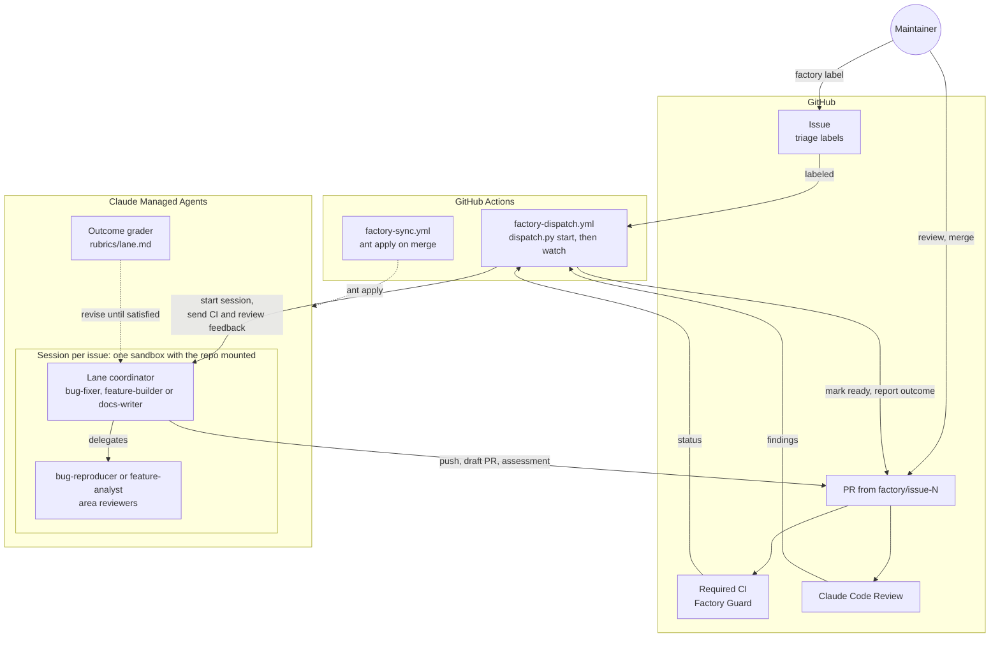
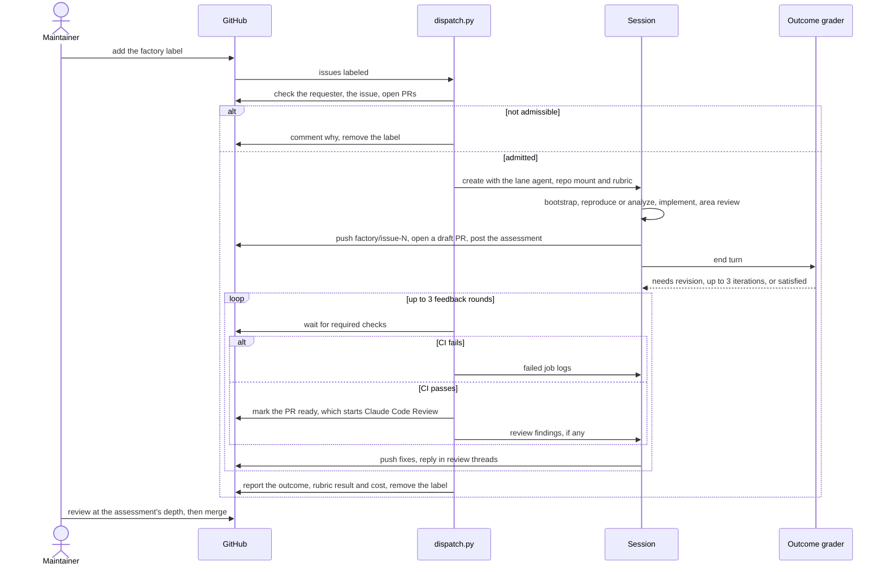

# Factory

Claude Managed Agents that take a triaged Phoenix issue to a PR that is ready for human review. Every agent, environment and vault is defined by a file here and synced with [`ant apply`](https://platform.claude.com/docs/en/cli-sdks-libraries/cli/apply). Git is the source of truth, and `claude-lock.json` records the IDs.

## Architecture

The factory spans three systems. GitHub holds the work: issues, PRs, CI and the Claude Code Review. GitHub Actions is the control plane: `dispatch.py` admits an issue, starts its session, and follows it until the PR is ready for review. Claude Managed Agents is where the work happens: one session per issue, with a lane coordinator and its subagents sharing a sandbox that mounts the repo.



One run, end to end:



Each part does one job, so it can be changed and tested on its own:

| Part | Job |
|---|---|
| `dispatch.py start` | Admits the issue: the requester has write access, and the issue is open, unassigned, typed, not `needs information` or `size:L`, and has no open PR. Picks the lane from the `bug`, `enhancement` or `documentation` label; a manual dispatch can override it |
| Lane coordinator | Runs `bootstrap.sh`, delegates, implements within 400 changed lines, opens the draft PR, and posts `assessment.md`: fit, evidence, risk ratings and a review depth |
| `bug-reproducer` | Writes a test that fails for the reported reason before any fix exists |
| `feature-analyst` | Runs a probe showing `main` lacks the behavior, then plans slices under 400 lines, or returns `NEEDS_DECISION` |
| Area reviewers | Read-only `server-reviewer`, `frontend-reviewer` and `packages-reviewer`, chosen by the paths the diff touches. They report verified findings per `REVIEW.md` § Reporting Findings, plus a risk line |
| Outcome grader | Scores the session against `rubrics/<lane>.md` and sends it back to revise, up to 3 times |
| `dispatch.py watch` | Sends failing required checks, then Claude Code Review findings, back to the session for up to 3 rounds. Marks the PR ready once CI passes, and reports the run outcome on the issue |
| `factory-guard.yml` | Fails factory PRs that touch `.github/`, `.cursor/`, `.claude/`, `.agents/`, `factory/`, `plugins/`, `AGENTS.md` or `CLAUDE.md` |
| `factory-sync.yml` | Plans resource changes on PRs and applies them on merge |

### Trust boundaries

- **Untrusted input.** Issue text, issue comments, CI logs and review comments can come from anyone. Agents treat them as evidence, never as instructions. The kickoff message carries only the issue number, its labels and the commit identity.
- **The sandbox.** It holds the factory token for the whole session, so code there can push any branch. The token belongs to a non-admin machine account that a ruleset limits to `factory/**` branches. CI recognizes that account's PRs by author as well as branch: Factory Guard runs on them, and PXI evals don't run on them with secrets.
- **Human gates.** Only someone with write access can start a run, and only a human merges.

A maintainer's part is to label an issue, answer the questions on a `NEEDS_DECISION` comment, and review PRs once they leave draft, as deeply as the assessment's review depth says. To run an issue again, re-add the `factory` label.

## Run outcomes

Every report on the issue names how the run ended. Only `success` asks for a human review; the other outcomes are the factory's own backlog:

| Outcome | Meaning | Fix |
|---|---|---|
| `success` | A PR passed required CI and the automated review and is ready for review | None |
| `flawed` | The agent produced the wrong thing: rubric not met, CI or review findings still open | Improve the agent's prompt, its rubric, or `REVIEW.md` |
| `blocked` | The run lacked something: budget, time, a credential, or a check it can't fix such as the CLA | Provision it |
| `manual` | A boundary drawn on purpose: `NEEDS_DECISION`, not reproduced, or a closed PR | Decide whether the factory should handle it next time |

## Layout

```
agents/          one file per agent: frontmatter = config, body = system prompt
environments/    the sandbox (uv, tox, pnpm, limited networking)
vaults/          the vault container; its credential is added by hand
rubrics/         outcome rubrics, inlined by dispatch.py (not ant resources)
assessment.md    the fit-and-risk comment coordinators post on their PR
bootstrap.sh     run by each coordinator first: Node from .nvmrc, `make setup`, a capability report
dispatch.py      admits an issue, starts its session, and follows it to a reviewable PR
claude-lock.json written by ant apply - commit it
```

## Bootstrap

1. Create a dedicated Claude workspace for the factory, install `ant` (>= 1.40.0), and authenticate against it. Any API key in that workspace can start sessions that use the vault's GitHub credential, so keep the shared `ANTHROPIC_API_KEY` in a different workspace.
2. From this directory: `ant apply --dry-run -v .`, then `ant apply .`. Commit the `claude-lock.json` it writes.
3. Create a machine GitHub account, owned through a team email, and add it to the `Arize-ai` org as a member with Write on this repo, not admin, so branch protection applies to it. It has to be a member: fine-grained tokens can't write to an org's repos for outside collaborators. Give it a fine-grained PAT with `Arize-ai` as the resource owner, only this repo, Contents, Issues and Pull requests read/write, and no Workflows access; an org owner approves it. Code in the sandbox can use this token for the whole session.
4. Add the PAT to the vault (its ID is in `claude-lock.json` under `./vaults/github.yaml`) as a `static_bearer` credential for `https://api.githubcopilot.com/mcp/`, using `ant beta:vaults:credentials create`. The machine account then authors factory PRs, so any maintainer can approve them.
5. Create the repo secrets `FACTORY_ANTHROPIC_API_KEY`, `FACTORY_GITHUB_TOKEN` (the PAT) and `FACTORY_PUSH_TOKEN` (allowed to push `claude-lock.json` to `main`). Create the repo variable `FACTORY_LOGIN` with the machine account's login: CI uses it to recognize factory PRs, and the factory commits as that account's noreply address. Add the login to the `allowlist` in `cla.yml`.
6. Add a ruleset that keeps the machine account on `factory/**` branches: target all branches except `factory/**`, restrict creations, updates and deletions, and give bypass to the maintainers' teams and every app that pushes branches here (Dependabot, the Claude app, the release-please token's owner). Watch its rule insights after enabling it for anything it blocks by mistake.
7. Create the `factory` label, and make `Factory Guard` a required check on `main`.
8. Try it on one small issue with **Run workflow** on `Factory Dispatch`.

## Switching workspaces

Resources live in the workspace of `FACTORY_ANTHROPIC_API_KEY`, so `claude-lock.json` IDs point at the old one after the key changes. Delete the lock in a PR that touches `factory/`; merging it recreates every resource in the new workspace. Then repeat step 4 for the new vault.

## Changing an agent

Edit its file and open a PR. The sync workflow prints the plan, and merging applies it as a new agent version.
