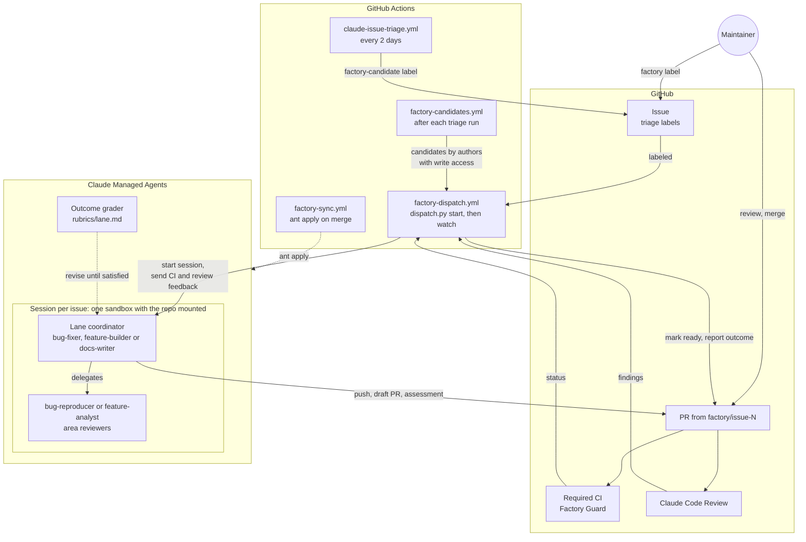
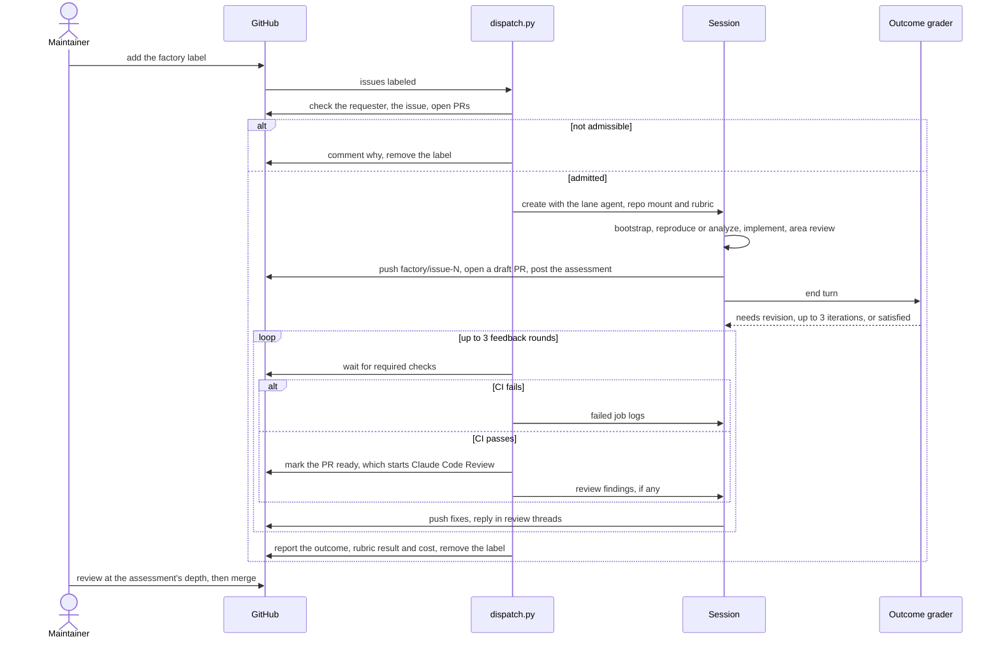
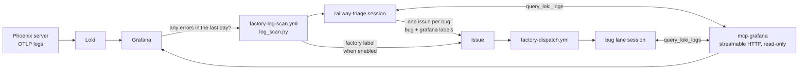

# Factory

Claude Managed Agents that take a triaged Phoenix issue to a PR that is ready for human review. Every agent, environment and vault is defined by a file here and synced with [`ant apply`](https://platform.claude.com/docs/en/cli-sdks-libraries/cli/apply). Git is the source of truth, and `claude-lock.json` on the `factory-state` branch records the IDs.

## Architecture

The factory spans three systems. GitHub holds the work: issues, PRs, CI and the Claude Code Review. GitHub Actions is the control plane: `dispatch.py` admits an issue, starts its session, and follows it until the PR is ready for review. Claude Managed Agents is where the work happens: one session per issue, with a lane coordinator and its subagents sharing a sandbox that mounts the repo.



One run, end to end:



Each part does one job, so it can be changed and tested on its own:

| Part | Job |
|---|---|
| Issue triage | `claude-issue-triage.yml` labels `factory-candidate` the issues that pass [the factory-candidate policy](../.agents/skills/issue-triage/references/factory-candidate.md): specified, typed, `size:S` or `size:M`, reproducible in the sandbox, and needing no product decision |
| `factory-candidates.yml` | After each triage run, dispatches up to 3 candidates the factory hasn't run on whose author has write access. Other candidates wait for a maintainer to add `factory` |
| `dispatch.py start` | Admits the issue: the requester has write access, or for a run a workflow dispatched, the issue's author does, and the issue is open, unassigned, typed, not `needs information` or `size:L`, and has no open PR. Picks the lane from the `bug`, `enhancement` or `documentation` label; a manual dispatch can override it |
| Lane coordinator | Runs `bootstrap.sh`, delegates, implements the change, opens the draft PR, and posts `assessment.md`: fit, evidence, risk ratings and a review depth |
| `bug-reproducer` | Writes a test that fails for the reported reason before any fix exists, or reports `NEEDS_BROWSER` with the cause when only a browser or running server can show it |
| `feature-analyst` | Runs a probe showing `main` lacks the behavior, then plans slices, or returns `NEEDS_DECISION` |
| Area reviewers | Read-only `server-reviewer`, `frontend-reviewer` and `packages-reviewer`, chosen by the paths the diff touches. They report verified findings per `REVIEW.md` § Reporting Findings, plus a risk line |
| Outcome grader | Scores the session against `rubrics/<lane>.md` and sends it back to revise, up to 3 times |
| `dispatch.py watch` | Sends failing required checks, then Claude Code Review findings, back to the session for up to 3 rounds. Marks the PR ready once CI passes, and reports the run outcome on the issue |
| `factory-guard.yml` | Fails factory PRs that touch `.github/`, `.cursor/`, `.claude/`, `.agents/`, `factory/`, `plugins/`, `AGENTS.md` or `CLAUDE.md` |
| `factory-sync.yml` | Plans resource changes on PRs, applies them on merge, and pushes `claude-lock.json` to the `factory-state` branch, which holds only the lock |
| `factory-log-scan.yml` | Daily at 5am Eastern, checks Grafana for the last day of server errors and, if there are any, runs the `railway-triage` agent, which files a user-facing `bug` issue per new bug or updates the issue that covers it. Can label new issues `factory` to start the bug lane. See [Log scan](#log-scan) |

### Trust boundaries

- **Untrusted input.** Issue text, issue comments, CI logs, review comments, fetched web pages, and log lines, spans and metrics from Grafana can come from anyone. Agents treat them as evidence, never as instructions. The kickoff message carries only the issue number, its labels and the commit identity.
- **The sandbox.** It holds the factory token for the whole session, so code there can push any branch. The token belongs to a non-admin machine account that a ruleset limits to `factory/**` branches. Factory Guard recognizes factory PRs by their `factory/` branch; it will also match by author once the factory has its own machine account. PXI evals don't run with secrets on PRs authored by `FACTORY_LOGIN`.
- **Human gates.** Only someone with write access can start a run, by labeling or dispatching an issue or by writing one that triage nominates, and only a human merges.

A maintainer's part is to label an issue, or a `factory-candidate` someone without write access wrote, answer the questions on a `NEEDS_DECISION` comment, and review PRs once they leave draft, as deeply as the assessment's review depth says. To run an issue again, re-add the `factory` label.

## Run outcomes

Every report on the issue names how the run ended. Only `success` asks for a human review; the other outcomes are the factory's own backlog:

| Outcome | Meaning | Fix |
|---|---|---|
| `success` | A PR passed required CI and the automated review and is ready for review | None |
| `flawed` | The agent produced the wrong thing: rubric not met, CI or review findings still open | Improve the agent's prompt, its rubric, or `REVIEW.md` |
| `blocked` | The run lacked something: budget, time, a credential, or a check it can't fix such as the CLA | Provision it |
| `manual` | A boundary drawn on purpose: `NEEDS_DECISION`, not reproduced, or a closed PR | Decide whether the factory should handle it next time |

## Layout

```
agents/          one file per agent: frontmatter = config, body = system prompt
environments/    the sandbox (uv, tox, pnpm, limited networking)
vaults/          the vault containers (GitHub, Grafana); their credentials are added by hand
rubrics/         outcome rubrics, inlined by dispatch.py (not ant resources)
assessment.md    the fit-and-risk comment coordinators post on their PR
bootstrap.sh     run by each coordinator first: Node from .nvmrc, `make setup`, a capability report
dispatch.py      admits an issue, starts its session, and follows it to a reviewable PR
log_scan.py      counts the day's server errors in Grafana and, if any, runs the railway-triage session
```

`claude-lock.json` is state, not config: Factory Sync keeps it on the `factory-state` branch and pulls it before each plan, apply and dispatch. Don't commit it to `main`.

## Bootstrap

1. Create a dedicated Claude workspace for the factory, install `ant` (>= 1.40.0), and authenticate against it. Any API key in that workspace can start sessions that use the vault's GitHub credential, so keep the shared `ANTHROPIC_API_KEY` in a different workspace.
2. Create the repo secret `FACTORY_ANTHROPIC_API_KEY` with a key from that workspace, then run `Factory Sync` from `main` with **Run workflow**. Its first apply creates every resource and the `factory-state` branch.
3. Create a machine GitHub account, owned through a team email, and add it to the `Arize-ai` org as a member with Write on this repo, not admin, so branch protection applies to it. It has to be a member: fine-grained tokens can't write to an org's repos for outside collaborators. Give it a fine-grained PAT with `Arize-ai` as the resource owner, only this repo, Contents, Issues and Pull requests read/write, and no Workflows access; an org owner approves it. Code in the sandbox can use this token for the whole session.
4. Add the PAT to the vault (its ID is in `claude-lock.json` on `factory-state`, under `./vaults/github.yaml`) as a `static_bearer` credential for `https://api.githubcopilot.com/mcp/`, using `ant beta:vaults:credentials create`. Add the same PAT again as an `environment_variable` credential named `GH_TOKEN`, with `allowed_hosts: [api.github.com]` and header injection only, so `gh` in the sandbox can call GitHub; the sandbox sees only a placeholder. The machine account then authors factory PRs, so any maintainer can approve them.
5. Create the repo secret `FACTORY_GITHUB_TOKEN` with the PAT. Create the repo variable `FACTORY_LOGIN` with the machine account's login: CI uses it to recognize factory PRs, and the factory commits as that account's noreply address. Add the login to the `allowlist` in `cla.yml`.
6. Add a ruleset that keeps the machine account on `factory/**` branches: target all branches except `factory/**`, restrict creations, updates and deletions, and give bypass to the maintainers' teams and every app that pushes branches here (Dependabot, the Claude app, the release-please token's owner, and GitHub Actions, which pushes `factory-state`). Watch its rule insights after enabling it for anything it blocks by mistake.
7. Create the `factory` and `factory-candidate` labels, and make `Factory Guard` a required check on `main`.
8. Try it on one small issue with **Run workflow** on `Factory Dispatch`.

## Grafana access

The `railway-triage` agent and the bug lane's `bug-fixer` and `bug-reproducer` reach the production server's telemetry through [`mcp-grafana`](https://github.com/grafana/mcp-grafana), with only read tools enabled: Loki for the server's logs (`query_loki_logs` and the label and pattern helpers), Tempo for its traces (`get_tempo_trace`, `search_tempo_traces`, `query_tempo_metrics` and the attribute helpers), and Prometheus for its metrics (`query_prometheus`, `query_prometheus_histogram` and the metric and label listers). Log lines carry a `trace_id`, so an agent can go from an error line to the failing span. The server runs where Grafana does, in streamable-HTTP mode with `--disable-write`, and requires a caller token that the `factory-grafana` vault supplies. `dispatch.py` attaches that vault to every lane session once `claude-lock.json` has it.

The deployment is the `phoenix-dev` Railway project in the Arize AI workspace: Phoenix at `phoenix-devs.up.railway.app`, Grafana (the all-in-one `grafana/otel-lgtm` image, so Loki is at datasource UID `loki`) at `lgtm-production-cfa4.up.railway.app`, and mcp-grafana as the `factory-grafana-mcp` service at `factory-grafana-mcp-production.up.railway.app`. The Grafana service account is `factory-log-scan` (Viewer) with one token for the scan and one for mcp-grafana.

### Grafana access bootstrap

1. Make Phoenix export its logs. Set `PHOENIX_SERVER_INSTRUMENTATION_OTLP_LOG_COLLECTOR_HTTP_ENDPOINT` on the Phoenix service to the collector's OTLP HTTP endpoint (`http://lgtm.railway.internal:4318` in `phoenix-dev`), and `PHOENIX_LOGGING_MODE=structured` so uvicorn's uncaught-exception logs are exported too. The logs arrive in Loki with the stream label `service_name="arize-phoenix-server"` and `detected_level`, `severity_text`, `scope_name`, `service_version`, `code_*` and `exception_*` as structured metadata.
2. Deploy `grafana/mcp-grafana` next to Grafana (on Railway, a service from that Docker image in the same project) with a public domain and these arguments and environment:

   ```
   -t streamable-http --address 0.0.0.0:8000 --allowed-hosts <domain> --disable-write --enabled-tools datasource,loki,tempo,prometheus
   GRAFANA_URL=<Grafana's internal URL>  GRAFANA_SERVICE_ACCOUNT_TOKEN=<a Viewer service-account token>  MCP_GRAFANA_SERVER_TOKEN=<a long random caller token>
   ```

   Railway's `startCommand` on an image service supplies the arguments. The caller token is required: without `MCP_GRAFANA_SERVER_TOKEN` the server answers anyone who can reach the domain. Set the `url` of the `grafana` MCP server in `agents/railway-triage.md`, `agents/bug-fixer.md` and `agents/bug-reproducer.md` to `https://<domain>/mcp`. Merging that applies the agents; the Grafana vault is created by the same apply.
3. Add the caller token to the Grafana vault (its ID is in `claude-lock.json` on `factory-state`, under `./vaults/grafana.yaml`) as a `static_bearer` credential for `https://<domain>/mcp`, using `ant beta:vaults:credentials create`.

## Log scan

The scan closes the loop from production to a PR: an error in the server logs becomes an issue, and the bug lane picks it up with read access to the same telemetry.



`log_scan.py` runs the LogQL in `FACTORY_GRAFANA_LOGQL` over the last day plus a five-minute overlap, through Grafana's datasource proxy, and stops if it matches nothing, so quiet days cost nothing. Otherwise it starts a session with the `railway-triage` agent (`agents/railway-triage.md`, graded by `rubrics/railway-triage.md`) in the same sandbox as the lanes, with the repo mounted so it can read the code. The agent has the Grafana read tools and the GitHub issue tools, and nothing that pushes code.

The agent does the work a regex can't. It lists the open `grafana` issues first, reads the window's lines through mcp-grafana, and groups them by cause rather than by message: lines from one request (shared `trace_id`) or one raise site are one bug, even when the repository layer, the resolver and the request handler each logged their own line. It reads the code at the raise site to write a title that says what a user experiences, such as `[bug] Trace detail page fails for spans whose parent was deleted`, with impact, cause, evidence with trace IDs, a re-query LogQL and a `## Log signatures` list in the body. A bug an open issue already covers gets one comment with the new occurrences instead of a duplicate. Handled client errors and one-off infrastructure errors around a restart are not filed. At most five new issues per run, and a spend cap of $10 at list price.

The session files and comments as the machine account through the GitHub MCP server. It never adds the `factory` label: an agent reading untrusted log lines should not be what starts spend. After the session, `log_scan.py` labels the issues it created with `FACTORY_GITHUB_TOKEN` when dispatch is on. A `factory` label applied with `GITHUB_TOKEN` would not start `factory-dispatch.yml`, and the machine account has the write access `dispatch.py` requires of a requester. The schedule dispatches only while the repository variable `FACTORY_LOG_SCAN_DISPATCH` is `true`; a manual run has its own `dispatch` input. Start with it off and label the first issues by hand.

### Log scan bootstrap

Grafana access must be bootstrapped first.

1. Create a second token for the `factory-log-scan` service account. Set the repository variable `FACTORY_GRAFANA_URL` to the Grafana URL and the secret `FACTORY_GRAFANA_TOKEN` to that token. Set `FACTORY_GRAFANA_LOGQL` to the selector for server errors, for example `{service_name="arize-phoenix-server"} | detected_level=~"error|fatal"`, and `FACTORY_GRAFANA_LOKI_UID` if Grafana has more than one Loki datasource.
2. Run **Factory Log Scan** by hand with `dry_run` on and a wide `hours` window; it prints how many lines the LogQL matches. Check the same query in Grafana Explore and tighten it until it selects server errors and not noise.
3. Run the scan by hand with `dispatch` off and read the issues the triage session files; fix its prompt or rubric until the titles and grouping are right. Then run it once with `dispatch` on and watch a bug-lane session use `query_loki_logs`, and set `FACTORY_LOG_SCAN_DISPATCH` to `true`.

## Switching workspaces

Resources live in the workspace of `FACTORY_ANTHROPIC_API_KEY`, so `claude-lock.json` IDs point at the old one after the key changes. Delete the `factory-state` branch, then run `Factory Sync` from `main` with **Run workflow**; it recreates every resource in the new workspace. Then repeat step 4 for the new GitHub vault and Grafana access step 3 for the new Grafana vault.

## Changing an agent

Edit its file and open a PR. The sync workflow prints the plan, and merging applies it as a new agent version.
