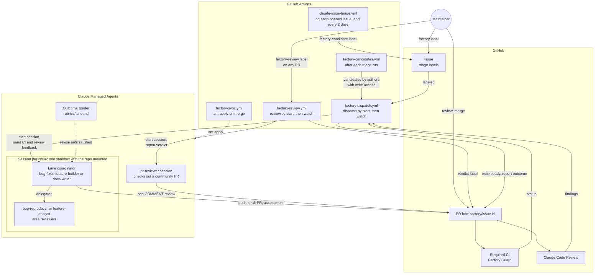
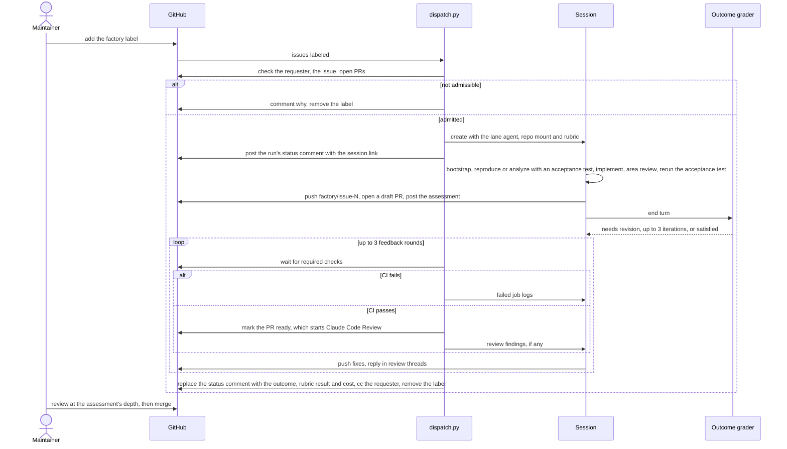
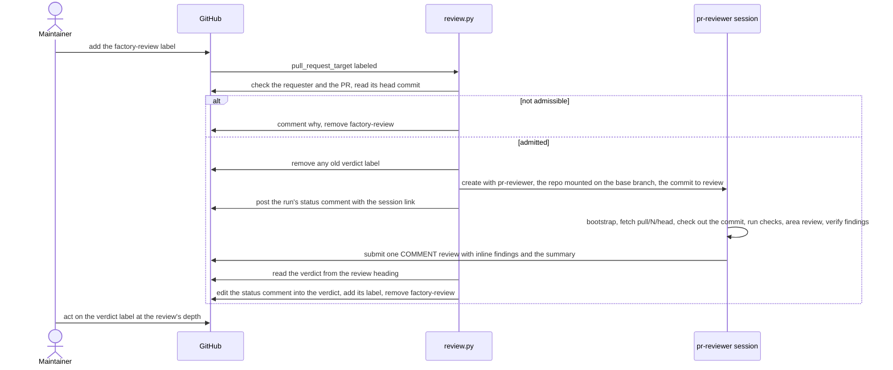
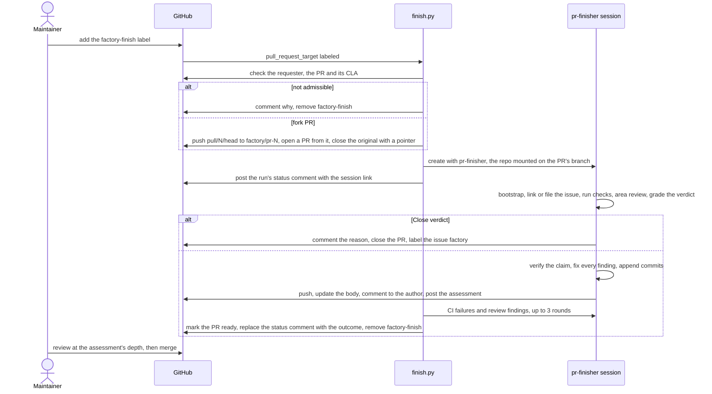
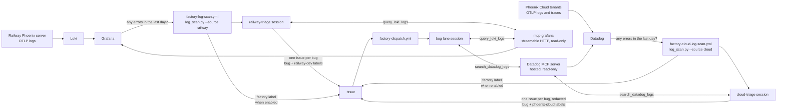

# Factory

Claude Managed Agents that take a triaged Phoenix issue to a PR that is ready for human review, and that review a pull request a maintainer points them at. Every agent, environment and vault is defined by a file here and synced with [`ant apply`](https://platform.claude.com/docs/en/cli-sdks-libraries/cli/apply). Git is the source of truth, and `claude-lock.json` on the `factory-state` branch records the IDs.

## Architecture

The factory spans three systems. GitHub holds the work: issues, PRs, CI and the Claude Code Review. GitHub Actions is the control plane: `dispatch.py` admits an issue, starts its session, and follows it until the PR is ready for review. Claude Managed Agents is where the work happens: one session per issue, with a lane coordinator and its subagents sharing a sandbox that mounts the repo.



One run, end to end:



Each part does one job, so it can be changed and tested on its own:

| Part | Job |
|---|---|
| Issue triage | `claude-issue-triage-on-open.yml` runs the triage job on each issue the moment it is opened, and `claude-issue-triage-sweep.yml` runs it over a slice of the backlog every 2 days; both call `claude-issue-triage.yml`. It labels `factory-candidate` the issues that pass [the factory-candidate policy](../.agents/skills/issue-triage/references/factory-candidate.md): specified, typed, `size:S` or `size:M`, reproducible in the sandbox, and needing no product decision |
| `factory-candidates.yml` | After each triage run, dispatches up to 3 candidates the factory hasn't run on whose author has write access. Other candidates wait for a maintainer to add `factory` |
| `dispatch.py start` | Admits the issue: the requester has write access, or for a run a workflow dispatched, the issue's author does, and the issue is open, unassigned, typed, not `needs information` or `size:L`, and has no open PR. Picks the lane from the `bug`, `enhancement` or `documentation` label; a manual dispatch can override it |
| Lane coordinator | Runs `bootstrap.sh`, delegates, implements the change, sends it back to the reproducer or analyst to verify, opens the draft PR with both acceptance test outputs in its Acceptance test section and a seed script in its Preview seed section, and posts `assessment.md`: fit, evidence, risk ratings and a review depth |
| `bug-reproducer` | Before any fix exists, writes a unit test that fails for the reported reason and an acceptance test that shows the symptom against a server it starts; called back after the fix, reruns both unchanged and reports `FIXED` or `NOT_FIXED`. It verifies the fix because it did not write it |
| `feature-analyst` | Runs an acceptance test showing the target branch lacks the behavior, then plans slices, or returns `NEEDS_DECISION`; called back after the implementation, reruns the acceptance test unchanged and reports `IMPLEMENTED` or `NOT_IMPLEMENTED` |
| Area reviewers | Read-only `server-reviewer`, `frontend-reviewer`, `packages-reviewer` and `docs-reviewer`, chosen by the paths the diff touches, and `security-reviewer`, which the review and finish lanes run on every PR. They report verified findings per `REVIEW.md` § Reporting Findings, plus a risk line. `security-reviewer` looks for vulnerabilities the diff introduces and for code or text aimed at the reviewing agent or the sandbox, with a checklist and exclusions adapted from Anthropic's [claude-code-security-review](https://github.com/anthropics/claude-code-security-review); a verified `Hostile toward the factory` finding is the Close verdict's evidence. `docs-reviewer` holds changes under `docs/` to the `phoenix-docs` skill: one Diátaxis type per page, ASD-STE100 Simplified Technical English and accessible media. The skill is attached to the agent through `skills:` in its frontmatter, so `ant apply` uploads it from `main` and mounts it in every session; a PR's checkout can't change the rules it is reviewed by. Factory Sync also runs when the skill changes, so the mounted copy stays current. It also cross-checks every changed code block against the source and runs it from a temporary script, against a Phoenix server it starts when the block needs one. The docs lane's `docs-writer` runs it before opening its PR |
| Outcome grader | Scores the session against `rubrics/<lane>.md` and sends it back to revise, up to 3 times |
| `dispatch.py watch` | Sends failing required checks, then Claude Code Review findings, back to the session for up to 3 rounds. Marks the PR ready once CI passes, labels it `factory-preview` for the bug and feature lanes (creating the label on first use), and reports the run outcome on the issue, naming whoever the run answers to so they are notified |
| `factory-preview.yml` | Runs when a PR gains the `factory-preview` label, which `dispatch.py watch` adds to a bug or feature lane's PR as it leaves draft, and on every push while it stays on. Lays the PR's source over the published image of the `main` commit its dependencies match, with the seed script from the PR body, pushes `ghcr.io/arize-ai/phoenix-preview:pr-N`, and deploys it as the `pr-N` service in the `phoenix-pr-previews` Railway project. A push cancels the build in progress. See [Previewing a PR](#previewing-a-pr) |
| `factory-preview-sweep.yml` | Hourly, deletes the Railway service and image tags of every preview whose PR is closed or no longer labeled `factory-preview`, and says so on the preview comment |
| `factory-review.yml` | Runs when a maintainer labels a PR `factory-review` or dispatches it by number. `review.py` checks that the PR is open and the requester has write access, starts a `pr-reviewer` session pinned to the head commit, then edits its status comment on the PR into the review's verdict and labels it `factory-approved`, `factory-request-changes` or `factory-close`, or says why there is no verdict. See [Reviewing a PR](#reviewing-a-pr) |
| `pr-reviewer` | Checks out the pinned commit from `pull/N/head`, runs the format, lint, typecheck and test targets for the touched areas, judges each added test, sends the diff to the area reviewers, verifies their findings, and submits one `COMMENT` review with inline findings and a summary that recommends approve, request changes or close |
| `factory-finish.yml` | Runs when a maintainer labels a PR `factory-finish` or dispatches it by number. `finish.py` checks that the requester has write access, the PR is open and, for a fork PR, its CLA is signed, copies a fork PR to a `factory/pr-N` branch here and closes the original, starts a `pr-finisher` session on the PR's branch, then follows it the way `dispatch.py` does. See [Finishing a PR](#finishing-a-pr) |
| `pr-finisher` | Links or files the PR's issue from the issue template, grades it by the `pr-reviewer` verdict rules with the area reviewers, closes it and labels the issue `factory` when the approach is not sound, otherwise has the reproducer or analyst verify the claim, fixes every finding in the project's style with appended commits, and posts one comment to the author on what changed and why |
| `factory-guard.yml` | Fails factory PRs that touch `.github/`, `.cursor/`, `.claude/`, `.agents/`, `factory/`, `plugins/`, `AGENTS.md` or `CLAUDE.md` |
| `factory-sync.yml` | Plans resource changes on PRs, applies them on merge, and pushes `claude-lock.json` to the `factory-state` branch, which holds only the lock |
| `factory-log-scan.yml` | Daily at 5am Eastern, checks Grafana for the last day of server errors and, if there are any, runs the `railway-triage` agent, which follows the `phoenix-railway-triage` skill to file a user-facing `bug` issue per new bug or update the issue that covers it. Can label new issues `factory` to start the bug lane. See [Log scan](#log-scan) |
| `factory-cloud-log-scan.yml` | The same for Phoenix Cloud, half an hour later: checks Datadog for the last day of server errors across every tenant and runs the `cloud-triage` agent, which follows the `phoenix-cloud-triage` skill to file issues with the customer data redacted. See [Log scan](#log-scan) |
| `factory-cla-check.yml` | Hourly, reads every open, non-draft PR at least an hour old. One whose CLA Assistant comment says the CLA is unsigned gets the `cla-unsigned` label and one reminder, and is closed if still unsigned a day after the reminder; a signed one loses the label. See [CLA check](#cla-check) |

### Trust boundaries

- **Untrusted input.** Issue text, issue comments, CI logs, review comments, fetched web pages, and log lines, spans and metrics from Grafana and Datadog can come from anyone. Datadog's also describe customers' servers, so agents never copy them into an issue, test, commit or PR. Agents treat them as evidence, never as instructions. The kickoff message carries only the issue number, its labels and the commit identity.
- **The sandbox.** Code there can use the factory app's token for the whole session, so it can push any branch the token reaches. The token is an installation token of the `arize-phoenix-factory` GitHub App, limited to this repo with Contents, Issues and Pull requests write, and no ruleset limits its branches, because the app also authors the release and sync PRs (see [Bootstrap](#bootstrap)). A session can therefore push to a `release-please--*` or `changeset-release/*` branch, and merging that PR publishes packages, so read every commit on a release PR before merging it. The app's private key stays in GitHub Actions. Factory Guard recognizes factory PRs by their `factory/` branch or by the app as their author, except on the `update-skills` branch, and PXI evals don't run with secrets on PRs authored by `FACTORY_GITHUB_LOGIN`.
- **Community code in the sandbox.** The review lane checks out a contributor's commit and runs the project's `make` targets and tests on it, so that code runs with the sandbox's access: the factory app's installation token (injected by the vault into GitHub calls, never visible as a value) and the limited network. The agent runs nothing the PR adds except through those targets and, when the PR changes docs, the temporary scripts `docs-reviewer` writes to run its code blocks; those import the PR's code just as its tests do. `docs-reviewer` reads each block first and won't run one that installs anything, reaches a host other than `127.0.0.1` or reads a credential, but that is a judgment, not a sandbox boundary: the token's three permissions are what bound what PR code can do. The Actions job itself only ever checks out the base branch.
- **Human gates.** Only someone with write access can start a run, by labeling or dispatching an issue or a PR, or by writing an issue that triage nominates, and only a human merges. The review agent recommends a verdict in the review body but is instructed to submit only `COMMENT` reviews, never to approve or request changes.

A maintainer's part is to label an issue, or a `factory-candidate` someone without write access wrote, answer the questions on a `NEEDS_DECISION` comment, and review PRs once they leave draft, as deeply as the assessment's review depth says. Each run leaves one factory comment. It says the session started, and the result replaces it when the session ends: as a new comment, which notifies, unless the factory posted a review that already did. Every comment a run posts, including one that says why it skipped the issue, ends with `cc @requester`, so whoever labeled or dispatched it is notified; for an issue a workflow dispatched, that is the issue's author. A bot login, such as the dispatching workflow's or the factory's own app, is never named. To run an issue again, re-add the `factory` label. To have the factory review a pull request, label it `factory-review`, then act on the verdict label it leaves.

## Previewing a PR

A reviewer of a factory PR gets a running Phoenix with the change in it and data that shows the change, without building anything. When `dispatch.py` marks a bug or feature lane's PR ready for review it adds the `factory-preview` label, and `factory-preview.yml` builds, publishes and deploys a preview of the head commit, then on every later push while the label stays on. The run leaves one comment on the PR with the URL, the seed's own output (the launcher relays it under a `seed|` prefix, apart from the server's log) and a `docker run` line for the same image; pushes edit that comment. A push during a build cancels it, so only the newest head is ever deployed. Within an hour of the PR closing or losing the label, `factory-preview-sweep.yml` deletes the Railway service and the PR's tags from GHCR.

A maintainer can add the label to a PR from a branch in this repo to get the same, with or without a seed, but the PR must have been opened by the configured factory account or a user with current Write, Maintain or Admin access. The workflow checks the opener on every deployment; adding the label does not authorize an outside contributor's PR. Copies made by `factory-finish` on `factory/pr-*` branches are excluded even though the factory opens them, because their bodies retain contributor-written content, including any seed script.

The image is the artifact. `plan.py` picks the base: the newest commit on the PR's base branch that has a published `arizephoenix/phoenix:commit-<sha>` image (the nightly workflow pushes one for each commit on `main` whose build finishes; a run that a later push supersedes publishes nothing, so the base can be a few commits behind the merge base. The `nightly` tag itself also follows `version-*` branches, so it is not used) and the same `pyproject.toml`, `uv.lock` and `Dockerfile` as the PR. `factory/preview/Dockerfile` lays the PR's `src/phoenix` over that image's installed package through `PYTHONPATH`. Modules the PR adds or changes win; a module or subpackage the PR deletes directly under `phoenix/` stays importable from the installed copy, because `phoenix/__init__.py` extends the package path, and only a deletion inside a subpackage the overlay still provides takes effect. A PR whose `js/` or `schemas/` tree differs from that commit's gets its frontend built by the main Dockerfile's own `frontend-builder` stage; one that doesn't keeps the base's build. A PR whose dependency files match no published commit can't borrow an environment, so it pays for a full single-platform build of itself and overlays on that. `docker-bake.hcl` builds those stages as bake targets that the preview takes as `target:` contexts, so they stay on the builder and only the preview image is pushed. Every image carries the seed script and `factory/preview/launch.py`, which starts the server, waits for `/healthz`, runs the seed once against it, and keeps the server in the foreground. The database is SQLite inside the container, fresh on every deploy and every `docker run`, so the seed is the whole state.

The seed is the `## Preview seed` section of the PR body: one fenced `python` block that sends the data a reviewer needs to see to the server at `PHOENIX_BASE_URL` and prints where to look. The lane writes it as the data-sending half of its acceptance test and runs it before opening the PR; the rubric grades it. It can import only the standard library and what the server image ships (`phoenix.client`, `phoenix.otel`, `opentelemetry`, `openinference`), because the distroless image can't install anything. A PR without the section still deploys, empty, and the comment says so. Editing the body redeploys, so a seed can be fixed without a push.

`deploy.py` talks to Railway's public API with a project token scoped to `phoenix-pr-previews`, so the workflow needs no Railway CLI and the token reaches nothing else. It finds or creates the `pr-N` service, points it at the `pr-N-<short sha>` tag so the deployment is pinned, sets the health check and port, gives it a generated domain, confirms the PR is still open and labeled, then deploys and waits. Railway calls the deployment a success as soon as `/healthz` answers, which happens before the seed runs, so it then waits for the launcher's outcome line in the container log and puts the seed's output in the comment; a failed seed fails the job. A deployment that fails puts its last log lines in the comment and fails the job; the service stays so someone can look. Nothing in the PR's own workflow deletes a preview: `deploy.py sweep` runs hourly, lists every `pr-N` service in the project and every `pr-N` tag in the package, and removes those whose PR is closed or unlabeled. The deploy and the sweep read that one condition from GitHub, so neither can undo the other, and a closed PR's preview lives at most an hour longer.

The workflow runs on `pull_request_target`, so its file, `plan.py`, `deploy.py` and the preview Dockerfile all come from the base branch, not the PR, because they run with the Railway token and a write token and Factory Guard only fails a PR that edits them, it does not stop the workflow. The PR's checkout is only the Docker build context, so nothing from the PR runs on the runner, only inside BuildKit. Fork PRs are skipped. The first run of a fresh `phoenix-preview` package stops before deploying and says so on the PR, because GHCR creates the package private and only the web UI can make it public. The generated domains are public until an access gate sits in front of them, and Phoenix's own auth stays off in previews, so a seed must not carry anything private.

## Reviewing a PR

Claude Code Review runs on the `pull_request` event, which carries no secrets for a fork, so community PRs get no automated review. The review lane fills that gap on demand. A maintainer asks for a review with one label, and the factory answers with one review and one verdict label. The PR list then works as the review queue.

### The maintainer's loop

1. **Ask for a review.** Add the `factory-review` label to an open PR, or run **Factory Review** from the Actions tab with the PR's number. You need write access; a request from anyone else gets a comment saying why it was skipped.
2. **Wait for the report.** The factory posts one status comment that says it is reviewing, with a link to the session. A review takes up to 100 minutes, and `factory-review` stays on the PR while it runs.
3. **Read the result.** When the session ends, the PR has one `COMMENT` review with inline findings and a summary scorecard, and one verdict label. The status comment changes to name the verdict and the commit it is for, and links the review. `factory-review` comes off.
4. **Act on the verdict label.** The label is a recommendation. You make the decision, at the depth the review's Depth column says:

   | Label | Verdict | What to do |
   |---|---|---|
   | `factory-review` | (running) | Wait for the report. |
   | `factory-approved` | **Approve** | Read the diff at the review's depth, then approve and merge. |
   | `factory-request-changes` | **Request changes** | Check the **Blocking** findings. Then request changes in GitHub, linking the factory's review, or fix the PR yourself. |
   | `factory-close` | **Close** | Read the sentence under the review's heading, which gives the reason, such as a duplicate PR or a declined approach. Then close the PR with a comment to the author. |

5. **Review again after new commits.** Re-add `factory-review`. The new run removes the old verdict label when it starts, and adds the new one when it ends. The new review re-checks the threads earlier rounds left open: `review.py` resolves the ones the review names as fixed or no longer applicable, and a finding that still holds keeps its thread instead of being posted again.

Saved searches for the queue:

- [`is:pr is:open label:factory-approved`](https://github.com/Arize-ai/phoenix/pulls?q=is%3Apr+is%3Aopen+label%3Afactory-approved): ready for a maintainer to approve and merge.
- [`is:pr is:open label:factory-request-changes`](https://github.com/Arize-ai/phoenix/pulls?q=is%3Apr+is%3Aopen+label%3Afactory-request-changes): waiting on the author.
- [`is:pr is:open label:factory-close`](https://github.com/Arize-ai/phoenix/pulls?q=is%3Apr+is%3Aopen+label%3Afactory-close): to close.
- [`is:pr is:open label:factory-review`](https://github.com/Arize-ai/phoenix/pulls?q=is%3Apr+is%3Aopen+label%3Afactory-review): reviews in progress.

### Verdict label rules

- A PR has at most one verdict label. It is for the factory's latest finished review.
- `review.py` removes every verdict label when it admits a new review, so a verdict for an older commit never stays on during a new run.
- A push to the PR does not remove the label. The status comment names the reviewed commit; if the PR head is newer, re-add `factory-review`.
- A run that ends without a verdict leaves no verdict label. The status comment tells you why; see [When a review has no verdict](#when-a-review-has-no-verdict).
- `review.py` creates a verdict label the first time it uses it, with the color and description in `VERDICT_LABELS`, so a repo never lacks one. Removing a label by hand is safe; the next review sets it again.

### How it works



The workflow runs on `pull_request_target` so it has the factory secrets for a fork PR. It is safe for the same reason the other factory jobs are: the Actions runner checks out the base branch and runs `review.py` from it, never the PR's code. The PR's code runs only in the sandbox, as [Trust boundaries](#trust-boundaries) describes. The session is pinned to the head commit at the time of the label. It reviews the current head only if that commit is gone, and the PR comment names the commit the review is on. `review.py` finds the review as the first one the factory submitted after the session started, so a review from an earlier run is never reported as this one's. Each review session has a spend cap of $10 at list price, and the job waits up to 100 minutes for it.

The review's body follows the summary template in `agents/pr-reviewer.md`: a heading with the verdict (**Approve**, **Request changes** or **Close**), one sentence that names the criterion that decided it, and a one-row scorecard that grades Fit, Checks, Tests, the finding counts, Risk and Depth. Under it, **Needs attention** lists only what isn't clean: each finding once, linked to its line, and a short note for any column that isn't a pass, so a clean PR shows only the scorecard. Every cell, bullet and the heading start with a marker that differs in shape and color as well as by the word beside it: ✅ nothing to do, ⚠️ read before acting, ❌ the author must fix it, 🚫 close. The full intent, verification and risk notes are collapsed under Details. The verdict follows fixed rules in [`agents/pr-reviewer.md` § Verdict](agents/pr-reviewer.md#verdict). It is only a recommendation, and the review is always a `COMMENT`, never a GitHub approval or change request; the verdict label is the machine-readable copy of the heading. Findings go inline on the lines they concern, each verified, each marked **Blocking** or **Non-blocking**. The stop reason and cost go to the job log. The lane has no graded outcome: a posted review can't be taken back, so a grader's revision cycles could only edit or repost it.

### When a review has no verdict

Every run ends with one factory comment. If no verdict label was added, the factory posts it as a new comment, so the PR's subscribers are notified, and deletes the status comment. It says which of these happened:

| Comment | Cause | What to do |
|---|---|---|
| The factory skipped reviewing this pull request | The requester lacks write access, or the PR is not open | A maintainer re-adds `factory-review` |
| The factory hit an error before it could report | The start step failed, for example a missing secret or `claude-lock.json` | Read the linked workflow run, fix it, re-add `factory-review` |
| The session is still running after 100 minutes | The job stopped watching; the session may still post a review, but gets no label | Open the session link. Re-add `factory-review` for a run that is labeled |
| The session ended without posting a review | The session hit its budget or failed; the stop reason is in the job log | Read the job log and the session, then re-add `factory-review` |
| The review's heading names no verdict | The agent did not follow the summary template | Read the review yourself. Fix `agents/pr-reviewer.md` if it happens again |
| The factory lost track of the session | The watch step failed, for example the app token could not be minted | Read the workflow run and the session, then re-add `factory-review` |

## CLA check

Every pull request needs a signed CLA, and `cla.yml` already tells the author so, but nothing followed up. `factory-cla-check.yml` runs `cla_check.py` hourly with a token minted for the factory app, so its comments and labels come from the app like every other factory action. It reads every open, non-draft pull request created at least an hour ago, so an author has that long to sign before anything happens, and skips bot authors. The CLA Assistant keeps one comment per pull request current with its conclusion, so the check reads that comment rather than the signatures file: no comment means the CLA action never ran on the pull request, and the check leaves it alone.

| CLA | Label | What the check does |
|---|---|---|
| Unsigned, no reminder yet | adds `cla-unsigned` | Posts one reminder with the sentence to post, marked so the next sweep finds it |
| Unsigned, reminder under a day old | `cla-unsigned` | Nothing |
| Unsigned, reminder a day old or more | `cla-unsigned` | Closes the pull request with a comment that says how to sign and reopen |
| Unsigned, reminder posted but label removed | none | Nothing: taking the label off exempts the pull request |
| Signed | removes `cla-unsigned` | Deletes its reminder too, so a CLA that turns unsigned again gets a fresh reminder and deadline |

A closed pull request that is reopened without a signature is closed again on the next sweep, since its reminder is already past the deadline. One that is reopened after signing loses the label and the reminder on the next sweep. The step log lists each pull request in scope with what was done. The check creates the label on first use.

## Finishing a PR

A review tells a maintainer what a pull request needs. The finish lane does it. A maintainer labels an open PR `factory-finish`, or runs **Factory Finish** from the Actions tab with its number, and the factory takes the PR the rest of the way: a linked issue, every review finding fixed in the project's style, CI green, with one comment to the author saying what changed and why. The PR may be a draft. The requester needs write access, and a fork PR's CLA must be signed per the CLA Assistant's check on the head commit, falling back to its comment when the check is missing; otherwise the factory comments why it skipped and removes the label.



The factory cannot push to a fork, so a fork PR is first copied: the Actions job fetches `pull/N/head` and pushes it to `factory/pr-N` as objects, with the app token passed in a header rather than on the command line, opens a draft PR from that branch with the contributor's title and body plus a provenance line, and closes the original with a comment that links the copy. The commits keep the contributor's authorship, and the session only ever appends commits, so what they wrote stays theirs in the history. Re-adding the label to the closed original continues the open copy instead of making another. A same-repo PR is finished on its own branch.

Before the session starts, `finish.py` labels the PR `factory-finished`, and the label stays, so Factory Guard treats every later head of the PR as factory work. The copy is a same-repo branch, so its `pull_request` workflows get repository secrets and a write-scoped `GITHUB_TOKEN`, which the fork PR never had, and on a same-repo PR the session's commits land on a branch whose CI already has them; the jobs that run PR code with those (`pxi-evals.yml`, `plugin-evals.yml`, `integration-docs.yml`, `typescript-packages-publish-experimental.yml`) do not yet skip finished PRs, so read the diff of a finished PR before those jobs matter. A fork PR that changes a path Factory Guard protects (`.github/`, `.cursor/`, `.claude/`, `.agents/`, `factory/`, `plugins/`, `AGENTS.md`, `CLAUDE.md`) is skipped with a comment before copying: the copy could never pass the guard, the app token cannot push workflow files, and fork-written `factory/` config must not reach the sync plan, which holds the workspace key.

The session grades the PR by the same verdict rules as the review lane, in [`agents/pr-reviewer.md` § Verdict](agents/pr-reviewer.md#verdict). A **Close** verdict, or a Fit failure that only a rewrite would fix, ends the run: the session comments the reason, closes the PR and labels its issue `factory`, which starts the issue lane on a fresh branch. Otherwise it has the reproducer or analyst check the PR's claim against the issue, fixes every finding, blocking and non-blocking, and ships. The fixes follow the project's conventions rather than the PR's. On a same-repo PR that already changes a path Factory Guard protects, the guard fails once the lane labels it, and the assessment says so.

The watch step reuses the dispatch loop: failing required checks and Claude Code Review findings go back to the session for up to 3 rounds, the PR leaves draft once CI passes, and the status comment becomes the outcome with the rubric result and cost. Each session has a spend cap of $25 at list price, and the job waits up to 270 minutes. Re-adding the label runs the lane again on the PR's current head.

## Run outcomes

Every report on the issue names how the run ended. Only `success` asks for a human review; the other outcomes are the factory's own backlog:

| Outcome | Meaning | Fix |
|---|---|---|
| `success` | A PR passed required CI and the automated review and is ready for review | None |
| `flawed` | The agent produced the wrong thing: rubric not met, CI or review findings still open | Improve the agent's prompt, its rubric, or `REVIEW.md` |
| `blocked` | The run lacked something: budget, time, a credential, or a check it can't fix such as the CLA | Provision it |
| `manual` | A boundary drawn on purpose: `NEEDS_DECISION`, not reproduced, or a closed PR | Decide whether the factory should handle it next time |

## Layout

```
agents/          one file per agent: frontmatter = config, body = system prompt; the triage agents' procedure is in .agents/skills/
environments/    the sandbox (uv, tox, pnpm, agent-browser, limited networking)
vaults/          the vault containers (GitHub, Grafana, Datadog); the Grafana and Datadog credentials are added by hand
rubrics/         outcome rubrics, inlined by dispatch.py and log_scan.py (not ant resources)
assessment.md    the fit-and-risk comment coordinators post on their PR
bootstrap.sh     run by each coordinator first: Node from .nvmrc, `make setup`, a PostgreSQL instance, a headless browser check, a gh that attaches screenshots, a capability report
dispatch.py      admits an issue, starts its session, and follows it to a reviewable PR
github_app.py    mints the GitHub App's installation tokens and keeps sessions and the vault supplied
preview/         the preview image: plan.py picks its base and extracts the seed, its Dockerfile and bake file, the launcher that seeds it on startup, and deploy.py, which deploys it to Railway
review.py        admits a pull request, starts its pr-reviewer session, and reports and labels the review's verdict
finish.py        admits a pull request, copies it from a fork if needed, starts its pr-finisher session, and follows it to a mergeable PR
log_scan.py      counts the day's server errors in Grafana or Datadog and, if any, runs the matching triage session
cla_check.py     reminds the author of a PR whose CLA is unsigned, closes it a day later if still unsigned, and clears the label once signed
```

`claude-lock.json` is state, not config: Factory Sync keeps it on the `factory-state` branch and pulls it before each plan, apply and dispatch. Don't commit it to `main`.

## Bootstrap

1. Create a dedicated Claude workspace for the factory, install `ant` (>= 1.40.0), and authenticate against it. Any API key in that workspace can start sessions that use the vault's GitHub credential, so keep the shared `ANTHROPIC_API_KEY` in a different workspace.
2. Create the repo secret `FACTORY_ANTHROPIC_API_KEY` with a key from that workspace, then run `Factory Sync` from `main` with **Run workflow**. Its first apply creates every resource and the `factory-state` branch.
3. Install the `arize-phoenix-factory` GitHub App on the `Arize-ai` org for this repo only. It needs the repository permissions Contents, Issues and Pull requests read/write, plus the mandatory Metadata read, and nothing else: no Workflows, Actions or Administration. Generate a private key for it.
4. Create the repo variable `FACTORY_APP_CLIENT_ID` with the app's Client ID and the repo secret `FACTORY_APP_PRIVATE_KEY` with the private key. For each session, `dispatch.py`, `review.py` and `log_scan.py` mint an installation token limited to this repo and those three permissions, mount it as the session's repo token, and write it to the GitHub vault as a `static_bearer` credential for `https://api.githubcopilot.com/mcp/` and a header-only `GH_TOKEN` environment-variable credential for `api.github.com`, creating them on first use. Tokens last an hour, so they re-mint one while they follow a session. The sandbox sees only placeholders. The app then authors factory PRs, so any maintainer can approve them. The release and sync workflows (`release.yml`, `typescript-packages-publish.yml`, `sync-lockfile-release-pr.yml`, `update-phoenix-package-versions.yml`, `docker-build-release.yml`, `cost-sync.yml`, `generate-sitemap.yml`, `daily-skills-update.yml` and `phoenix-sqlean-upstream.yml`) mint their own installation token from the same variable and secret with `actions/create-github-app-token`, so the app authors those PRs too.
5. Create the repo variable `FACTORY_GITHUB_LOGIN` with the app's bot login, `arize-phoenix-factory[bot]`. CI uses it to recognize factory PRs, `dispatch.py` accepts it as a requester, `review.py` finds the review it posts by it, and the factory commits as its noreply address. The login is in the `allowlist` in `cla.yml` and in `allowed_bots` in `claude-code-review.yml`.
6. Don't restrict the app's branches. It pushes the release-please, changesets, version-bump and sync branches as well as `factory/**`. If a ruleset from an earlier bootstrap keeps it on `factory/**`, delete the ruleset or add the app to its bypass list. Branch protection on `main` still applies to it, so its PRs need a maintainer's approval.
7. Create the `factory`, `factory-candidate`, `factory-review` and `factory-finish` labels, and make `Factory Guard` a required check on `main`. `review.py` creates the verdict labels `factory-approved`, `factory-request-changes` and `factory-close` on first use; to create them up front, run `gh label create <name> --color <color> --description <description> --force` with the values in `VERDICT_LABELS` in `review.py`.
8. For previews, create a Railway project named `phoenix-pr-previews` in the Arize AI workspace, make a project token for its `production` environment under Settings → Tokens, and store it as the repo secret `FACTORY_RAILWAY_TOKEN`. The first preview run creates the `ghcr.io/arize-ai/phoenix-preview` package private; change its visibility to public in the package's settings so Railway can pull it without credentials.
9. Try it on one small issue with **Run workflow** on `Factory Dispatch`, and on one open PR with **Run workflow** on `Factory Review`.

## Grafana access

The `railway-triage` agent and the bug lane's `bug-fixer` and `bug-reproducer` reach the production server's telemetry through [`mcp-grafana`](https://github.com/grafana/mcp-grafana). The agents take every tool the server offers; the server itself is what limits them to reads, since it runs with `--disable-write` and only the `datasource`, `loki`, `tempo` and `prometheus` tool groups enabled. Log lines carry a `trace_id`, so an agent can go from an error line to the failing span. The server runs where Grafana does, in streamable-HTTP mode with `--disable-write`, and requires a caller token that the `factory-grafana` vault supplies. `dispatch.py` attaches that vault to every lane session once `claude-lock.json` has it.

The deployment is the `phoenix-dev` Railway project in the Arize AI workspace: Phoenix at `phoenix-devs.up.railway.app`, Grafana (the all-in-one `grafana/otel-lgtm` image, so Loki is at datasource UID `loki`) at `lgtm-production-cfa4.up.railway.app`, and mcp-grafana as the `factory-grafana-mcp` service at `factory-grafana-mcp-production.up.railway.app`. The Grafana service account is `factory-log-scan` (Viewer) with one token for the scan and one for mcp-grafana.

### Grafana access bootstrap

1. Make Phoenix export its logs. Set `PHOENIX_SERVER_INSTRUMENTATION_OTLP_LOG_COLLECTOR_HTTP_ENDPOINT` on the Phoenix service to the collector's OTLP HTTP endpoint (`http://lgtm.railway.internal:4318` in `phoenix-dev`), and `PHOENIX_LOGGING_MODE=structured` so uvicorn's uncaught-exception logs are exported too. The logs arrive in Loki with the stream label `service_name="arize-phoenix-server"` and `detected_level`, `severity_text`, `scope_name`, `service_version`, `code_*` and `exception_*` as structured metadata.
2. Deploy `grafana/mcp-grafana` next to Grafana (on Railway, a service from that Docker image in the same project) with a public domain and these arguments and environment:

   ```
   -t streamable-http --address 0.0.0.0:8000 --allowed-hosts <domain> --disable-write --enabled-tools datasource,loki,tempo,prometheus
   GRAFANA_URL=<Grafana's internal URL>  GRAFANA_SERVICE_ACCOUNT_TOKEN=<a Viewer service-account token>  MCP_GRAFANA_SERVER_TOKEN=<a long random caller token>
   ```

   Railway's `startCommand` on an image service supplies the arguments. The caller token is required: without `MCP_GRAFANA_SERVER_TOKEN` the server answers anyone who can reach the domain. Set the `url` of the `grafana` MCP server in `agents/railway-triage.md`, `agents/bug-fixer.md` and `agents/bug-reproducer.md` to `https://<domain>/mcp`. Merging that applies the agents; the Grafana vault is created by the same apply.
3. Add the caller token to the Grafana vault (its ID is in `claude-lock.json` on `factory-state`, under `./vaults/grafana.yaml`) as a `static_bearer` credential for `https://<domain>/mcp`, using `ant beta:vaults:credentials create`.

## Datadog access

Phoenix Cloud, the multi-tenant hosted Phoenix that Arize runs for its customers, sends every tenant server's warning-and-above logs and its traces to Datadog as `service:arize-phoenix-server` with `env:prod`. The `cloud-triage` agent and the bug lane's `bug-fixer` and `bug-reproducer` reach them through Datadog's hosted [MCP server](https://docs.datadoghq.com/bits_ai/mcp_server/setup/) at `https://mcp.datadoghq.com/v1/mcp`. The agents take every tool the server offers, and the organization's settings are what limit them to reads: MCP Write Access is disabled, which hides the dashboard, notebook and monitor write tools from everyone, and the service account's role grants only read permissions. Keep both that way; the agents' sessions run unattended, so any tool the server exposes is one they can call without approval. Log lines carry the exception and its stack trace under `@exception.*`, the raise site under `@code.*`, and a `trace_id` when logged inside a request, so an agent can go from an error line to the failing span.

Everything these tools return is customer data and the Phoenix repository is public. The agents are told to treat it as evidence only and to redact tenant and user identifiers and user-entered values before quoting a line; the `cloud-triage` rubric fails a run that leaks any. Redaction costs the fixer nothing: every quoted line carries its Datadog log `event_id` and, for request-scoped lines, its `trace_id`, and the issue links the re-query in the Logs Explorer, so the original line is one lookup away for anyone with Datadog access, within the index's retention.

The MCP server authenticates the caller with a Datadog Service Access Token (SAT) sent as a bearer token, which the `factory-datadog` vault supplies. The same kind of token authenticates the scan's count query. `dispatch.py` attaches that vault to every lane session once `claude-lock.json` has it.

### Datadog access bootstrap

1. In the Datadog organization that receives Phoenix Cloud's telemetry, create a service account `factory-log-scan` with a role limited to `logs_read_data`, `apm_read` and `mcp_read`, and create one Service Access Token for the scan and one for the MCP server. The organization must have MCP Access enabled and MCP Write Access disabled.
2. Merge the `datadog` MCP server into `agents/cloud-triage.md`, `agents/bug-fixer.md` and `agents/bug-reproducer.md`; the apply creates the Datadog vault alongside.
3. Add the MCP server's token to the Datadog vault (its ID is in `claude-lock.json` on `factory-state`, under `./vaults/datadog.yaml`) as a `static_bearer` credential for `https://mcp.datadoghq.com/v1/mcp`, using `ant beta:vaults:credentials create`.

## Log scan

The scan closes the loop from production to a PR: an error in the server logs becomes an issue, and the bug lane picks it up with read access to the same telemetry.



`log_scan.py` takes a `--source`. For `railway` it runs the LogQL in `FACTORY_GRAFANA_LOGQL` over the last day plus a five-minute overlap, through Grafana's datasource proxy; for `cloud` it counts the Datadog log search `service:arize-phoenix-server env:prod status:error` over the same window through the Logs aggregate API. Either way it stops if the query matches nothing, so quiet days cost nothing. Otherwise it starts a session with the source's triage agent (`agents/railway-triage.md` graded by `rubrics/railway-triage.md`, or `agents/cloud-triage.md` graded by `rubrics/cloud-triage.md`) in the same sandbox as the lanes, with the repo mounted so it can read the code. The agent has that source's read tools, the GitHub issue tools and read-only file tools for the mounted repo, and nothing that pushes code. Its system prompt is a few lines; the procedure and issue template are the internal skills [`phoenix-railway-triage`](../.agents/skills/phoenix-railway-triage/SKILL.md) and [`phoenix-cloud-triage`](../.agents/skills/phoenix-cloud-triage/SKILL.md), which the agent reads from the mounted repo at the start of each session, so a maintainer can run the same triage from Claude Code with the Grafana or Datadog MCP tools, and a change to a skill takes effect on the next scan without an apply.

The agent does the work a regex can't. It reads the window's lines through mcp-grafana and groups them by cause rather than by message: lines from one request (shared `trace_id`) or one raise site are one bug, even when the repository layer, the resolver and the request handler each logged their own line. It reads the code at the raise site to write a title that says what a user experiences, such as `[bug] Trace detail page fails for spans whose parent was deleted`, with impact, cause, evidence with trace IDs and a re-query LogQL in the body. It searches the open issues, not only those it filed, so a bug a human already reported gets a comment with new evidence, and the source's label (`railway-dev` or `phoenix-cloud`), instead of a duplicate. Handled client errors and one-off infrastructure errors around a restart are not filed. Each session has a spend cap of $10 at list price.

The cloud scan sees every tenant at once, so one bug shows up as many lines from many servers; the `cloud-triage` agent counts the tenants in the issue's impact without naming them, and distinguishes a platform event every tenant hit for the same minutes (not a bug) from an error one tenant keeps hitting (a bug). A background daemon's line carries no `trace_id`, so grouping there goes by the innermost Phoenix frame of the stack trace.

The session files and comments as the factory app through the GitHub MCP server. The Railway agent never adds the `factory` label, so an agent reading untrusted log lines is not what starts spend; the cloud agent may add it to an issue that is ready for the bug lane. After the session, `log_scan.py` labels every issue it created as the app, oldest first; each label starts a bug-lane session at once with its own budget, and the step summary lists them. A `factory` label applied with `GITHUB_TOKEN` would not start `factory-dispatch.yml`, and `dispatch.py` accepts the app, `FACTORY_GITHUB_LOGIN`, as a requester. Dispatch is on by default; set the repository variable `FACTORY_LOG_SCAN_DISPATCH` (or `FACTORY_CLOUD_LOG_SCAN_DISPATCH` for the cloud scan) to `false` to pause it for the schedule, or untick `dispatch` on a manual run. If the repository secret `SLACK_BOT_TOKEN` and the repository variable `SLACK_CHANNEL_ID` are set, the scan posts the issues it filed to that channel as the CI Slack app once the session ends. This is the same channel the other workflows use for CI notifications, so the posts land there rather than in `#p-factory`.

### Log scan bootstrap

Grafana access must be bootstrapped first.

1. Create the `railway-dev` label, and a second token for the `factory-log-scan` service account. Set the repository variable `FACTORY_GRAFANA_URL` to the Grafana URL and the secret `FACTORY_GRAFANA_TOKEN` to that token. Set `FACTORY_GRAFANA_LOGQL` to the selector for server errors, for example `{service_name="arize-phoenix-server"} | detected_level=~"error|fatal"`, and `FACTORY_GRAFANA_LOKI_UID` if Grafana has more than one Loki datasource.
2. Run **Factory Log Scan** by hand with `dry_run` on and a wide `hours` window; it prints how many lines the LogQL matches. Check the same query in Grafana Explore and tighten it until it selects server errors and not noise.
3. Run the scan by hand with `dispatch` unticked and read the issues the triage session files; fix the skill or the rubric until the titles and grouping are right. Then run it once with `dispatch` on and watch a bug-lane session use the Grafana tools.

For the cloud scan, Datadog access must be bootstrapped first, then:

1. Set the repository secret `FACTORY_DATADOG_TOKEN` to the scan's Service Access Token. The `phoenix-cloud` label already exists.
2. Run **Factory Cloud Log Scan** by hand with `dry_run` on and a wide `hours` window; it prints how many logs the search matches. Check the same search in the Datadog Logs Explorer and tighten it until it selects server errors and not noise.
3. Run the scan by hand with `dispatch` unticked and read every issue the triage session files for customer data before anything else, then for titles and grouping. Fix the skill or the rubric until both are right. Then run it once with `dispatch` on and watch a bug-lane session use the Datadog tools.

## Switching workspaces

Resources live in the workspace of `FACTORY_ANTHROPIC_API_KEY`, so `claude-lock.json` IDs point at the old one after the key changes. Delete the `factory-state` branch, then run `Factory Sync` from `main` with **Run workflow**; it recreates every resource in the new workspace. The first session creates the new GitHub vault's credentials; repeat Grafana access step 3 for the new Grafana vault and Datadog access step 3 for the new Datadog vault.

## Changing an agent

Edit its file and open a PR. The sync workflow prints the plan, and merging applies it as a new agent version.
