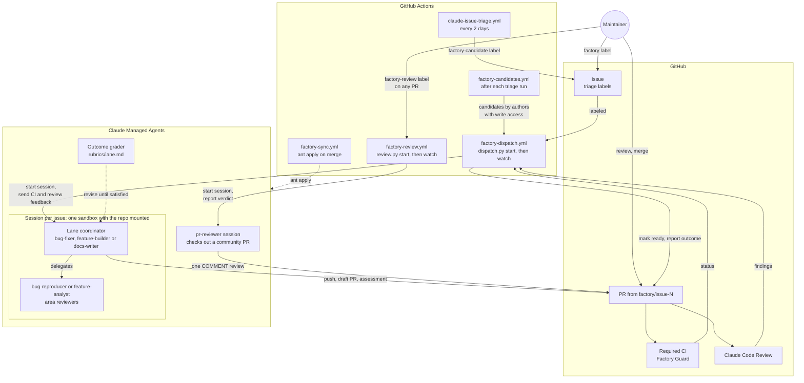
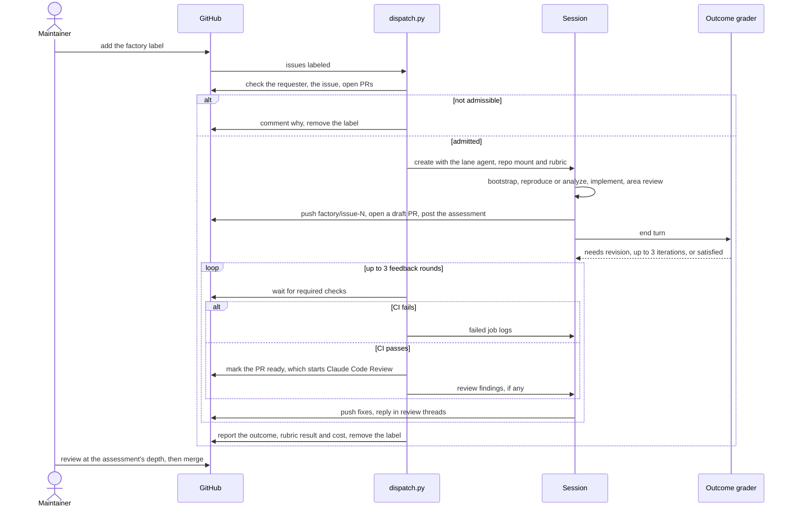
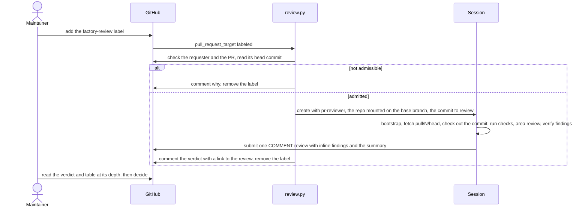
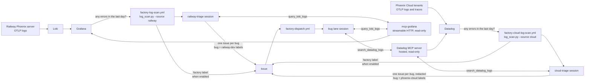

# Factory

Claude Managed Agents that take a triaged Phoenix issue to a PR that is ready for human review, and that review a pull request a maintainer points them at. Every agent, environment and vault is defined by a file here and synced with [`ant apply`](https://platform.claude.com/docs/en/cli-sdks-libraries/cli/apply). Git is the source of truth, and `claude-lock.json` on the `factory-state` branch records the IDs.

## Architecture

The factory spans three systems. GitHub holds the work: issues, PRs, CI and the Claude Code Review. GitHub Actions is the control plane: `dispatch.py` admits an issue, starts its session, and follows it until the PR is ready for review. Claude Managed Agents is where the work happens: one session per issue, with a lane coordinator and its subagents sharing a sandbox that mounts the repo.



One run, end to end:



Each part does one job, so it can be changed and tested on its own:

| Part | Job |
|---|---|
| Issue triage | `claude-issue-triage.yml` labels `factory-candidate` the issues that pass [the factory-candidate policy](../.agents/skills/issue-triage/references/factory-candidate.md): specified, typed, `size:S` or `size:M`, reproducible in the sandbox, and needing no product decision |
| `factory-candidates.yml` | After each triage run, dispatches up to 3 candidates the factory hasn't run on whose author has write access. Other candidates wait for a maintainer to add `factory` |
| `dispatch.py start` | Admits the issue: the requester has write access, or for a run a workflow dispatched, the issue's author does, and the issue is open, unassigned, typed, not `needs information` or `size:L`, and has no open PR. Picks the lane from the `bug`, `enhancement` or `documentation` label; a manual dispatch can override it |
| Lane coordinator | Runs `bootstrap.sh`, delegates, implements the change, opens the draft PR, and posts `assessment.md`: fit, evidence, risk ratings and a review depth |
| `bug-reproducer` | Writes a test that fails for the reported reason before any fix exists, or reports `NEEDS_BROWSER` with the cause when only a browser or running server can show it |
| `feature-analyst` | Runs a probe showing `main` lacks the behavior, then plans slices, or returns `NEEDS_DECISION` |
| Area reviewers | Read-only `server-reviewer`, `frontend-reviewer` and `packages-reviewer`, chosen by the paths the diff touches. They report verified findings per `REVIEW.md` § Reporting Findings, plus a risk line |
| Outcome grader | Scores the session against `rubrics/<lane>.md` and sends it back to revise, up to 3 times |
| `dispatch.py watch` | Sends failing required checks, then Claude Code Review findings, back to the session for up to 3 rounds. Marks the PR ready once CI passes, and reports the run outcome on the issue |
| `factory-review.yml` | Runs when a maintainer labels a PR `factory-review` or dispatches it by number. `review.py` checks that the PR is open and the requester has write access, starts a `pr-reviewer` session pinned to the head commit, and comments the review's verdict on the PR, or that none was posted. See [Reviewing a PR](#reviewing-a-pr) |
| `pr-reviewer` | Checks out the pinned commit from `pull/N/head`, runs the format, lint, typecheck and test targets for the touched areas, judges each added test, sends the diff to the area reviewers, verifies their findings, and submits one `COMMENT` review with inline findings and a summary that recommends approve, request changes or close |
| `factory-guard.yml` | Fails factory PRs that touch `.github/`, `.cursor/`, `.claude/`, `.agents/`, `factory/`, `plugins/`, `AGENTS.md` or `CLAUDE.md` |
| `factory-sync.yml` | Plans resource changes on PRs, applies them on merge, and pushes `claude-lock.json` to the `factory-state` branch, which holds only the lock |
| `factory-log-scan.yml` | Daily at 5am Eastern, checks Grafana for the last day of server errors and, if there are any, runs the `railway-triage` agent, which files a user-facing `bug` issue per new bug or updates the issue that covers it. Can label new issues `factory` to start the bug lane. See [Log scan](#log-scan) |
| `factory-cloud-log-scan.yml` | The same for Phoenix Cloud, half an hour later: checks Datadog for the last day of server errors across every tenant and runs the `cloud-triage` agent, which files issues with the customer data redacted. See [Log scan](#log-scan) |

### Trust boundaries

- **Untrusted input.** Issue text, issue comments, CI logs, review comments, fetched web pages, and log lines, spans and metrics from Grafana and Datadog can come from anyone. Datadog's also describe customers' servers, so agents never copy them into an issue, test, commit or PR. Agents treat them as evidence, never as instructions. The kickoff message carries only the issue number, its labels and the commit identity.
- **The sandbox.** Code there can use the factory app's token for the whole session, so it can push any branch the token reaches. The token is an installation token of the `arize-phoenix-factory` GitHub App, limited to this repo with Contents, Issues and Pull requests write, and a ruleset limits the app to `factory/**` branches. The app's private key stays in GitHub Actions. Factory Guard recognizes factory PRs by their `factory/` branch or by the app as their author, and PXI evals don't run with secrets on PRs authored by `FACTORY_GITHUB_LOGIN`.
- **Community code in the sandbox.** The review lane checks out a contributor's commit and runs the project's `make` targets and tests on it, so that code runs with the sandbox's access: the factory app's installation token (injected by the vault into GitHub calls, never visible as a value) and the limited network. The agent runs nothing the PR adds except through those targets, and the ruleset bounds what the token can do. The Actions job itself only ever checks out the base branch.
- **Human gates.** Only someone with write access can start a run, by labeling or dispatching an issue or a PR, or by writing an issue that triage nominates, and only a human merges. The review agent recommends a verdict in the review body but is instructed to submit only `COMMENT` reviews, never to approve or request changes.

A maintainer's part is to label an issue, or a `factory-candidate` someone without write access wrote, answer the questions on a `NEEDS_DECISION` comment, and review PRs once they leave draft, as deeply as the assessment's review depth says. To run an issue again, re-add the `factory` label. To have the factory review a pull request, label it `factory-review`.

## Reviewing a PR

Claude Code Review runs on the `pull_request` event, which carries no secrets for a fork, so community PRs get no automated review. The review lane fills that gap on demand: a maintainer adds the `factory-review` label to a PR, or runs **Factory Review** with its number, and `review.py` starts a `pr-reviewer` session in the factory sandbox.



The workflow runs on `pull_request_target` so it has the factory secrets for a fork PR, and it is safe for the same reason the other factory jobs are: the Actions runner checks out the base branch and runs `review.py` from it, never the PR's code. The PR's code runs only in the sandbox, as [Trust boundaries](#trust-boundaries) describes. The session is pinned to the head commit at the time of the label, and reviews the current head only if that commit is gone; the PR comment names the commit the review is on. `review.py` finds the review as the first one the factory submitted after the session started, so a review from an earlier run is never reported as this one's. Re-add the label to review a new head. Each review session has a spend cap of $10 at list price and the job waits up to 100 minutes for it.

The review's body follows the summary template in `agents/pr-reviewer.md`: a verdict of **Approve**, **Request changes** or **Close**, the one criterion that decided it, and a table grading Fit, Checks, Tests, the finding counts, Risk and Review depth, with the full intent, verification and risk notes collapsed under Details. The verdict follows fixed rules in [`agents/pr-reviewer.md` § Verdict](agents/pr-reviewer.md#verdict) and is only a recommendation; the review is always a `COMMENT`. Findings go inline on the lines they concern, each verified, each marked **Blocking** or **Non-blocking**. When the session ends, `review.py` comments the verdict on the PR with a link to the review, or says the session posted none; the stop reason and cost go to the job log. The lane has no graded outcome: a posted review can't be taken back, so a grader's revision cycles could only edit or repost it.

## Run outcomes

Every report on the issue names how the run ended. Only `success` asks for a human review; the other outcomes are the factory's own backlog:

| Outcome | Meaning | Fix |
|---|---|---|
| `success` | A PR passed required CI and the automated review and is ready for review | None |
| `flawed` | The agent produced the wrong thing: rubric not met, CI or review findings still open | Improve the agent's prompt, its rubric, or `REVIEW.md` |
| `blocked` | The run lacked something: budget, time, a credential, or a check it can't fix such as the CLA | Provision it |
| `manual` | A boundary drawn on purpose: `NEEDS_DECISION`, not reproduced, or a closed PR | Decide whether the factory should handle it next time |

## Layout

```
agents/          one file per agent: frontmatter = config, body = system prompt
environments/    the sandbox (uv, tox, pnpm, limited networking)
vaults/          the vault containers (GitHub, Grafana, Datadog); the Grafana and Datadog credentials are added by hand
rubrics/         outcome rubrics, inlined by dispatch.py and log_scan.py (not ant resources)
assessment.md    the fit-and-risk comment coordinators post on their PR
bootstrap.sh     run by each coordinator first: Node from .nvmrc, `make setup`, a capability report
dispatch.py      admits an issue, starts its session, and follows it to a reviewable PR
github_app.py    mints the GitHub App's installation tokens and keeps sessions and the vault supplied
review.py        admits a pull request, starts its pr-reviewer session, and reports the review it posts
log_scan.py      counts the day's server errors in Grafana or Datadog and, if any, runs the matching triage session
```

`claude-lock.json` is state, not config: Factory Sync keeps it on the `factory-state` branch and pulls it before each plan, apply and dispatch. Don't commit it to `main`.

## Bootstrap

1. Create a dedicated Claude workspace for the factory, install `ant` (>= 1.40.0), and authenticate against it. Any API key in that workspace can start sessions that use the vault's GitHub credential, so keep the shared `ANTHROPIC_API_KEY` in a different workspace.
2. Create the repo secret `FACTORY_ANTHROPIC_API_KEY` with a key from that workspace, then run `Factory Sync` from `main` with **Run workflow**. Its first apply creates every resource and the `factory-state` branch.
3. Install the `arize-phoenix-factory` GitHub App on the `Arize-ai` org for this repo only. It needs the repository permissions Contents, Issues and Pull requests read/write, plus the mandatory Metadata read, and nothing else: no Workflows, Actions or Administration. Generate a private key for it.
4. Create the repo variable `FACTORY_APP_CLIENT_ID` with the app's Client ID and the repo secret `FACTORY_APP_PRIVATE_KEY` with the private key. For each session, `dispatch.py`, `review.py` and `log_scan.py` mint an installation token limited to this repo and those three permissions, mount it as the session's repo token, and write it to the GitHub vault as a `static_bearer` credential for `https://api.githubcopilot.com/mcp/` and a header-only `GH_TOKEN` environment-variable credential for `api.github.com`, creating them on first use. Tokens last an hour, so they re-mint one while they follow a session. The sandbox sees only placeholders. The app then authors factory PRs, so any maintainer can approve them.
5. Create the repo variable `FACTORY_GITHUB_LOGIN` with the app's bot login, `arize-phoenix-factory[bot]`. CI uses it to recognize factory PRs, `dispatch.py` accepts it as a requester, `review.py` finds the review it posts by it, and the factory commits as its noreply address. The login is in the `allowlist` in `cla.yml` and in `allowed_bots` in `claude-code-review.yml`.
6. Add a ruleset that keeps the app on `factory/**` branches: target all branches except `factory/**`, restrict creations, updates and deletions, and give bypass to the maintainers' teams and every other app that pushes branches here (Dependabot, the Claude app, the release-please token's owner, and GitHub Actions, which pushes `factory-state`), but not the factory app. Watch its rule insights after enabling it for anything it blocks by mistake.
7. Create the `factory`, `factory-candidate` and `factory-review` labels, and make `Factory Guard` a required check on `main`.
8. Try it on one small issue with **Run workflow** on `Factory Dispatch`, and on one open PR with **Run workflow** on `Factory Review`.

## Grafana access

The `railway-triage` agent and the bug lane's `bug-fixer` and `bug-reproducer` reach the production server's telemetry through [`mcp-grafana`](https://github.com/grafana/mcp-grafana). The agents take every tool the server offers; the server itself is what limits them to reads, since it runs with `--disable-write` and only the `datasource`, `loki`, `tempo` and `prometheus` tool groups enabled. Log lines carry a `trace_id`, so an agent can go from an error line to the failing span. The server runs where Grafana does, in streamable-HTTP mode with `--disable-write`, and requires a caller token that the `factory-grafana` vault supplies. `dispatch.py` attaches that vault to every lane session once `claude-lock.json` has it.

The deployment is the `phoenix-dev` Railway project in the Arize AI workspace: Phoenix at `phoenix-devs.up.railway.app`, Grafana (the all-in-one `grafana/otel-lgtm` image, so Loki is at datasource UID `loki`) at `lgtm-production-cfa4.up.railway.app`, and mcp-grafana as the `factory-grafana-mcp` service at `factory-grafana-mcp-production.up.railway.app`. The Grafana service account is `factory-log-scan` (Viewer) with one token for the scan and one for mcp-grafana.

### Grafana access bootstrap

1. Make Phoenix export its logs. Set `PHOENIX_SERVER_INSTRUMENTATION_OTLP_LOG_COLLECTOR_HTTP_ENDPOINT` on the Phoenix service to the collector's OTLP HTTP endpoint (`http://lgtm.railway.internal:4318` in `phoenix-dev`), and `PHOENIX_LOGGING_MODE=structured` so uvicorn's uncaught-exception logs are exported too. The logs arrive in Loki with the stream label `service_name="arize-phoenix-server"` and `detected_level`, `severity_text`, `scope_name`, `service_version`, `code_*` and `exception_*` as structured metadata.
2. Deploy `grafana/mcp-grafana` next to Grafana (on Railway, a service from that Docker image in the same project) with a public domain and these arguments and environment:

   ```
   -t streamable-http --address 0.0.0.0:8000 --allowed-hosts <domain> --disable-write --enabled-tools datasource,loki,tempo,prometheus
   GRAFANA_URL=<Grafana's internal URL>  GRAFANA_SERVICE_ACCOUNT_TOKEN=<a Viewer service-account token>  MCP_GRAFANA_SERVER_TOKEN=<a long random caller token>
   ```

   Railway's `startCommand` on an image service supplies the arguments. The caller token is required: without `MCP_GRAFANA_SERVER_TOKEN` the server answers anyone who can reach the domain. Set the `url` of the `grafana` MCP server in `agents/railway-triage.md`, `agents/bug-fixer.md` and `agents/bug-reproducer.md` to `https://<domain>/mcp`. Merging that applies the agents; the Grafana vault is created by the same apply.
3. Add the caller token to the Grafana vault (its ID is in `claude-lock.json` on `factory-state`, under `./vaults/grafana.yaml`) as a `static_bearer` credential for `https://<domain>/mcp`, using `ant beta:vaults:credentials create`.

## Datadog access

Phoenix Cloud, the multi-tenant hosted Phoenix that Arize runs for its customers, sends every tenant server's warning-and-above logs and its traces to Datadog as `service:arize-phoenix-server` with `env:prod`. The `cloud-triage` agent and the bug lane's `bug-fixer` and `bug-reproducer` reach them through Datadog's hosted [MCP server](https://docs.datadoghq.com/bits_ai/mcp_server/setup/) at `https://mcp.datadoghq.com/v1/mcp`. The agents take every tool the server offers, and the organization's settings are what limit them to reads: MCP Write Access is disabled, which hides the dashboard, notebook and monitor write tools from everyone, and the service account's role grants only read permissions. Keep both that way; the agents' sessions run unattended, so any tool the server exposes is one they can call without approval. Log lines carry the exception and its stack trace under `@exception.*`, the raise site under `@code.*`, and a `trace_id` when logged inside a request, so an agent can go from an error line to the failing span.

Everything these tools return is customer data and the Phoenix repository is public. The agents are told to treat it as evidence only and to redact tenant and user identifiers and user-entered values before quoting a line; the `cloud-triage` rubric fails a run that leaks any.

The MCP server authenticates the caller with a Datadog Service Access Token (SAT) sent as a bearer token, which the `factory-datadog` vault supplies. The same kind of token authenticates the scan's count query. `dispatch.py` attaches that vault to every lane session once `claude-lock.json` has it.

### Datadog access bootstrap

1. In the Datadog organization that receives Phoenix Cloud's telemetry, create a service account `factory-log-scan` with a role limited to `logs_read_data`, `apm_read` and `mcp_read`, and create one Service Access Token for the scan and one for the MCP server. The organization must have MCP Access enabled and MCP Write Access disabled.
2. Merge the `datadog` MCP server into `agents/cloud-triage.md`, `agents/bug-fixer.md` and `agents/bug-reproducer.md`; the apply creates the Datadog vault alongside.
3. Add the MCP server's token to the Datadog vault (its ID is in `claude-lock.json` on `factory-state`, under `./vaults/datadog.yaml`) as a `static_bearer` credential for `https://mcp.datadoghq.com/v1/mcp`, using `ant beta:vaults:credentials create`.

## Log scan

The scan closes the loop from production to a PR: an error in the server logs becomes an issue, and the bug lane picks it up with read access to the same telemetry.



`log_scan.py` takes a `--source`. For `railway` it runs the LogQL in `FACTORY_GRAFANA_LOGQL` over the last day plus a five-minute overlap, through Grafana's datasource proxy; for `cloud` it counts the Datadog log search in `FACTORY_DATADOG_QUERY` over the same window through the Logs aggregate API. Either way it stops if the query matches nothing, so quiet days cost nothing. Otherwise it starts a session with the source's triage agent (`agents/railway-triage.md` graded by `rubrics/railway-triage.md`, or `agents/cloud-triage.md` graded by `rubrics/cloud-triage.md`) in the same sandbox as the lanes, with the repo mounted so it can read the code. The agent has that source's read tools and the GitHub issue tools, and nothing that pushes code.

The agent does the work a regex can't. It reads the window's lines through mcp-grafana and groups them by cause rather than by message: lines from one request (shared `trace_id`) or one raise site are one bug, even when the repository layer, the resolver and the request handler each logged their own line. It reads the code at the raise site to write a title that says what a user experiences, such as `[bug] Trace detail page fails for spans whose parent was deleted`, with impact, cause, evidence with trace IDs and a re-query LogQL in the body. It searches the open issues, not only those it filed, so a bug a human already reported gets a comment with new evidence, and the source's label (`railway-dev` or `phoenix-cloud`), instead of a duplicate. Handled client errors and one-off infrastructure errors around a restart are not filed. Each session has a spend cap of $10 at list price.

The cloud scan sees every tenant at once, so one bug shows up as many lines from many servers; the `cloud-triage` agent counts the tenants in the issue's impact without naming them, and distinguishes a platform event every tenant hit for the same minutes (not a bug) from an error one tenant keeps hitting (a bug). A background daemon's line carries no `trace_id`, so grouping there goes by the innermost Phoenix frame of the stack trace.

The session files and comments as the factory app through the GitHub MCP server. It never adds the `factory` label: an agent reading untrusted log lines should not be what starts spend. After the session, `log_scan.py` labels every issue it created as the app, oldest first; each label starts a bug-lane session at once with its own budget, and the step summary lists them. A `factory` label applied with `GITHUB_TOKEN` would not start `factory-dispatch.yml`, and `dispatch.py` accepts the app, `FACTORY_GITHUB_LOGIN`, as a requester. Dispatch is on by default; set the repository variable `FACTORY_LOG_SCAN_DISPATCH` (or `FACTORY_CLOUD_LOG_SCAN_DISPATCH` for the cloud scan) to `false` to pause it for the schedule, or untick `dispatch` on a manual run.

### Log scan bootstrap

Grafana access must be bootstrapped first.

1. Create the `railway-dev` label, and a second token for the `factory-log-scan` service account. Set the repository variable `FACTORY_GRAFANA_URL` to the Grafana URL and the secret `FACTORY_GRAFANA_TOKEN` to that token. Set `FACTORY_GRAFANA_LOGQL` to the selector for server errors, for example `{service_name="arize-phoenix-server"} | detected_level=~"error|fatal"`, and `FACTORY_GRAFANA_LOKI_UID` if Grafana has more than one Loki datasource.
2. Run **Factory Log Scan** by hand with `dry_run` on and a wide `hours` window; it prints how many lines the LogQL matches. Check the same query in Grafana Explore and tighten it until it selects server errors and not noise.
3. Run the scan by hand with `dispatch` unticked and read the issues the triage session files; fix its prompt or rubric until the titles and grouping are right. Then run it once with `dispatch` on and watch a bug-lane session use the Grafana tools.

For the cloud scan, Datadog access must be bootstrapped first, then:

1. Set the repository secret `FACTORY_DATADOG_TOKEN` to the scan's Service Access Token and the variable `FACTORY_DATADOG_QUERY` to the log search that selects server errors, for example `service:arize-phoenix-server env:prod status:error`. Set `FACTORY_DATADOG_SITE` only if the organization is not on `datadoghq.com`. The `phoenix-cloud` label already exists.
2. Run **Factory Cloud Log Scan** by hand with `dry_run` on and a wide `hours` window; it prints how many logs the search matches. Check the same search in the Datadog Logs Explorer and tighten it until it selects server errors and not noise.
3. Run the scan by hand with `dispatch` unticked and read every issue the triage session files for customer data before anything else, then for titles and grouping. Fix the prompt or rubric until both are right. Then run it once with `dispatch` on and watch a bug-lane session use the Datadog tools.

## Switching workspaces

Resources live in the workspace of `FACTORY_ANTHROPIC_API_KEY`, so `claude-lock.json` IDs point at the old one after the key changes. Delete the `factory-state` branch, then run `Factory Sync` from `main` with **Run workflow**; it recreates every resource in the new workspace. The first session creates the new GitHub vault's credentials; repeat Grafana access step 3 for the new Grafana vault and Datadog access step 3 for the new Datadog vault.

## Changing an agent

Edit its file and open a PR. The sync workflow prints the plan, and merging applies it as a new agent version.
