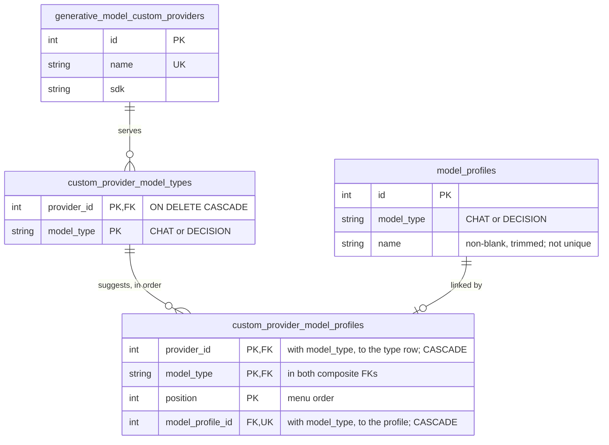

# Custom Provider Models

This document records how custom providers store the model types they serve and the model names they suggest, why the design uses tables, and its caveats. It names code by symbol, not by file line.

## Problem

A custom provider can serve chat models, decision models, or both, as its SDK allows. For each type it serves, it can suggest its own model names for the model menu, or use the SDK's built-in list. Phoenix has to store both facts so that every surface (the playground, prompts, decisions, and the provider settings) reads the same answer.

## Storage

### Tables

| Table | One row per | Key | Enforces |
|---|---|---|---|
| `custom_provider_model_types` | model type a provider serves | `(provider_id, model_type)` | `model_type IN ('CHAT', 'DECISION')` |
| `model_profiles` | suggested model name | `id` | known model type; name non-blank and trimmed |
| `custom_provider_model_profiles` | link from a served type to a profile, in menu order | `(provider_id, model_type, position)` | a served-type row exists; the profile has the same model type; each profile has one link |

`model_profiles` also declares `UNIQUE (id, model_type)`, because the foreign key from a link to its profile goes through `model_type` and needs a unique target. It always holds, since `id` is the primary key, so names stay non-unique.

- **No type row:** the provider doesn't serve that type.
- **A type row with no links:** the model menu shows the SDK's built-in list from `CLIENT_REGISTRY`. Built-in names are never copied into the database, so they can't go stale.
- **A type row with links:** the menu suggests those names, in `position` order. The names are suggestions, not an allowlist: any name the endpoint accepts works.

### Why tables

- **The database enforces the invariants.** Composite foreign keys through `model_type` make two bad states impossible: a link with no served-type row, and a decision profile listed under chat.
- **Sharing stays a write-path change.** Links point at profiles by ID, so profiles can later be shared between providers without a schema change. Today each provider gets its own profiles.
- **Names can be queried and referenced.** Plain SQL answers "which providers list `gpt-4o`", and each name has a row ID that other features could reference.

A single JSON column per provider would be simpler to read and write, and it would make names unique per type for free. But the database couldn't check what the column contains, and sharing profiles would need a schema change.

### In code

- `ProviderModels` (fields `chat` and `decision`) is the value callers read, through the read-only `GenerativeModelCustomProvider.models` property. `ProviderModels.get_models_of_type` is the one lookup from a type to its field.
- `ModelTypeKey` is `Literal["CHAT", "DECISION"]`. It's the same in the database, REST (`?model_type=`) and GraphQL (`ModelType`), so no boundary converts values.
- An ORM `init` event gives a provider built without `model_types` its SDK's default types: `CHAT` for chat SDKs, `DECISION` for TypeSafe.
- A patch holds the provider row's lock. For each type whose names changed, it deletes the profiles first (their links go with them), then the type row, and then rebuilds the type with `build_model_type_row`, the same builder that create uses. It sets `provider.updated_at` itself, because a change to type rows or links doesn't touch the provider row.
- `CustomProviderModelsDataLoader` loads the rows for GraphQL in batches.

### Migration

`4027185fa2cf` creates the tables and gives each existing provider one type row: `DECISION` for the TypeSafe SDK, `CHAT` for every other SDK. It runs before the decision tables (`e724eb2ee5cf`), because a decision run checks that its provider serves `DECISION`.

## Caveats

- **Names aren't unique in the database.** The write path trims names, drops blanks and removes duplicates before saving. A plain unique constraint can't enforce this, because the name is in `model_profiles` and the link holds only an ID.
- **Deleting a provider doesn't delete its profiles in the database.** Type rows and links cascade, but profiles don't, because the foreign key points from link to profile. The patch and delete mutations delete profiles in code. Other deletes, such as raw SQL, leave unused profile rows that nothing reads.
- **Profile IDs change on every edit of a type's names,** including names that didn't change. Nothing references them. The GraphQL input carries names only, so a rename is the same as a remove plus an add. A feature that references profile IDs would first need edits to keep the rows of unchanged names.
- **`UNIQUE (model_profile_id)` assumes profiles aren't shared.** Adding sharing means:
  - dropping that constraint, and making the delete paths keep any profile that other links still use;
  - never renaming a profile in place, which would rename it for every provider that links to it; a changed name links to another profile instead;
  - accepting that sharing is best-effort, because names aren't unique and two saves at the same moment can each create the same name;
  - deciding whether to clean up profiles that no link uses.
- **Defaults cover ORM inserts only.** A provider inserted with Core or raw SQL gets no type rows, and serves nothing until it is patched.
- **The name CHECK uses SQL `trim()`, which removes only spaces.** The write path strips all whitespace, so the CHECK is a backstop for other writers.
- **`position` only orders names.** The database doesn't require it to be non-negative or gapless. Writes always use `0..n-1`.
- **Concurrent patches serialize on the provider row lock** on PostgreSQL; the last save wins. SQLite serializes writes anyway.
