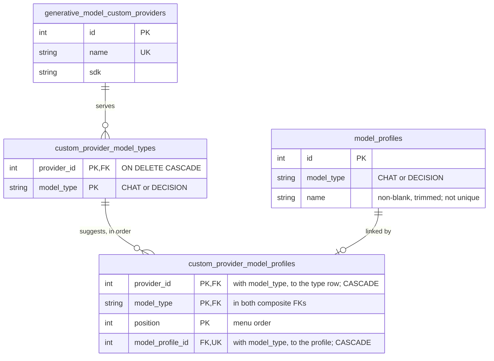

# Custom Provider Models

This document records how custom providers store the model types they serve and the model names they suggest, the design's trade-offs, and its caveats. It names code by symbol, not by file line.

## Problem

A custom provider serves chat models, decision models, or both, as its SDK allows. An SDK that offers chat always serves chat, so only a TypeSafe provider can serve decisions alone. For each type it serves, a provider either suggests its own model names for the model menu or uses the SDK's built-in list.

The model menus and the decision paths read what a provider serves. Chat validation and execution check the provider's SDK, not its served types, which is why chat can't be turned off.

`model_profiles` has nothing to do with `generative_models`, which holds model name patterns and token prices for cost tracking.

## Storage

### Tables

| Table | One row per | Key | Enforces |
|---|---|---|---|
| `custom_provider_model_types` | model type a provider serves | `(provider_id, model_type)` | `model_type IN ('CHAT', 'DECISION')` |
| `model_profiles` | suggested model name | `id` | known model type; name non-blank and trimmed |
| `custom_provider_model_profiles` | link from a served type to a profile, in menu order | `(provider_id, model_type, position)` | a served-type row exists; the profile has the same model type; each profile has one link |

`model_profiles` also declares `UNIQUE (id, model_type)`, because the foreign key from a link to its profile goes through `model_type` and needs a unique target. It always holds, since `id` is the primary key, so names stay non-unique.

- **No type row:** the provider doesn't serve that type.
- **A type row with no links:** the model menu shows the SDK's built-in list from `CLIENT_REGISTRY`. Built-in names are never copied into the database, so they can't go stale.
- **A type row with links:** the menu suggests those names, in `position` order. The names are suggestions, not an allowlist: any name the endpoint accepts works.

### Design trade-offs

What the layout provides:

- **The database enforces the served-type rules.** Composite foreign keys through `model_type` reject a link with no served-type row and a decision profile listed under chat.
- **Names can be queried in SQL,** for example "which providers list `gpt-4o`".
- **A model name is its own row.** `model_profiles` separates a model from where it is listed, which is what sharing profiles between providers or adding per-model fields would build on.

What it requires:

- A write path that replaces rows, a dataloader, an ORM `init` event for defaults, an explicit `updated_at` update, and profile cleanup on patch and delete.
- Three extra queries whenever an ORM query loads providers (see Caveats).
- Duplicate names per type are prevented in code, not by a constraint (see Caveats).

Sharing and per-model fields aren't implemented. Building on the layout for them would still take work:

- Sharing would mean dropping `UNIQUE (model_profile_id)` and changing the write and delete paths.
- Referencing a profile by ID would need edits to keep the rows of unchanged names, because every edit of a type's names recreates its profiles today.

### In code

- `ProviderModels` (fields `chat` and `decision`) is the value callers read, through the read-only `GenerativeModelCustomProvider.models` property. `ProviderModels.get_models_of_type` is the one lookup from a type to its field.
- `ModelTypeKey` is `Literal["CHAT", "DECISION"]`. The database, the GraphQL `ModelType` enum and the `model_type` parameter of `GET /v1/model_providers` use the same values, so no boundary converts them. The REST endpoints for custom providers don't expose served types or names.
- An ORM `init` event gives a provider built without `model_types` its SDK's default types: `CHAT` for chat SDKs, `DECISION` for TypeSafe.
- A patch holds the provider row's lock. For each type that is turned on, turned off or has its names changed, it deletes the profiles first (their links go with them), then the type row, and then rebuilds the type if it is still served. It uses `build_model_type_row`, the same builder that create uses.
- A patch sets `provider.updated_at` itself, because a change to type rows or links doesn't touch the provider row. Online-eval resolution fingerprints a custom provider by `(id, updated_at)`, so a change to what a provider serves has to move it.
- GraphQL fields that already hold the provider record, such as the provider list and mutation payloads, read its eagerly loaded rows. References that carry only an ID, such as `node(id:)`, `PromptVersion.customProvider` and `Decision.customProvider`, load them through `CustomProviderModelsDataLoader` in batches.
- Tables that reference a custom provider (decision versions, prompt versions, experiment tasks, agent sessions) have foreign keys to the provider row, not to a type row. Python checks the type instead. Saving a decision version reads the provider `FOR SHARE`, so a patch that stops the provider serving decisions waits for it, and the patch's reference check then sees the new version. Creating a decision experiment task takes no such lock; if the provider stops serving decisions first, the task fails when it runs, because the decision client checks again.

### Migration

`4027185fa2cf` creates the tables and gives each existing provider one type row: `DECISION` for the TypeSafe SDK, `CHAT` for every other SDK. It runs before the decision tables migration (`e724eb2ee5cf`), but neither reads the other's tables, so the order isn't load-bearing.

## Caveats

- **Names aren't unique in the database.** The write path trims names, drops blanks and removes duplicates before saving. A unique constraint can't enforce this, because the name is in `model_profiles` and the link holds only an ID.
- **Deleting a provider doesn't delete its profiles in the database.** Type rows and links cascade, but profiles don't, because the foreign key points from link to profile. The patch and delete mutations delete profiles in code. Other deletes, such as raw SQL, leave unused profile rows that nothing reads.
- **Profile IDs change on every edit of a type's names,** including names that didn't change. Nothing references them. The GraphQL input carries names only, so a rename is the same as a remove plus an add.
- **`UNIQUE (model_profile_id)` assumes profiles aren't shared.** Adding sharing means:
  - dropping that constraint, and making the delete paths keep any profile that other links still use;
  - never renaming a profile in place, which would rename it for every provider that links to it; a changed name links to another profile instead;
  - accepting that sharing is best-effort, because names aren't unique and two saves at the same moment can each create the same name;
  - deciding whether to clean up profiles that no link uses.
- **Loading providers runs three extra queries.** `model_types`, `profile_links` and `profile` load eagerly (`lazy="selectin"`), so every ORM query on providers fetches them, including queries that never read `.models`. `load_only` doesn't stop this. The queries are batched, not one per row.
- **Defaults cover ORM inserts only.** A provider inserted with Core or raw SQL gets no type rows, and serves nothing until it is patched.
- **The name CHECK uses SQL `trim()`, which removes only spaces.** The write path strips all whitespace, so the CHECK is a backstop for other writers.
- **`position` only orders names.** The database doesn't require it to be non-negative or gapless. Writes always use `0..n-1`.
- **Concurrent patches serialize on the provider row lock** on PostgreSQL; the last save wins. SQLite serializes writes anyway.
