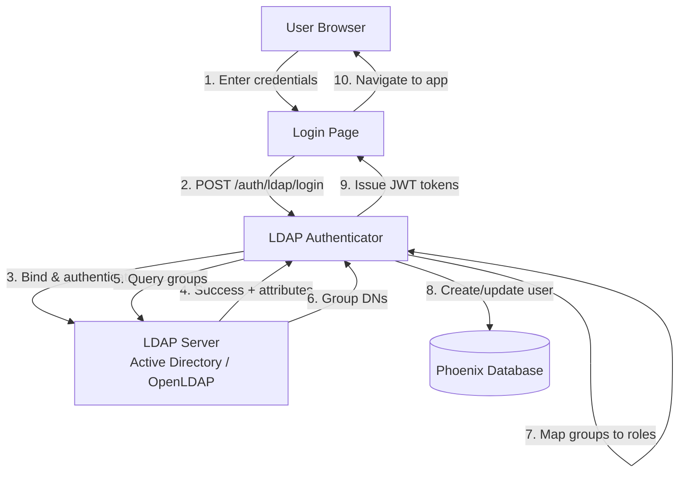

# LDAP Authentication Design Proposal for Phoenix

> **New to LDAP?** Start with the [LDAP Primer for OIDC Engineers](./ldap-authentication/ldap-primer.md) - explains LDAP fundamentals using OIDC as a reference point.

## Executive Summary

LDAP authentication for Phoenix enabling corporate user adoption. Supports Active Directory/OpenLDAP, group-based role mapping, multi-server failover, and Grafana-compatible configuration.

→ *Full details*: [Architecture Overview](#architecture-overview) | [Security & Risks](#security--risks) | [Implementation Status](#implementation-status) | [Grafana Compatibility](./ldap-authentication/grafana-comparison.md)

### The Decision

Phoenix's `users` table CHECK constraint (`auth_method IN ('LOCAL', 'OAUTH2')`) requires choosing between:

**Approach 1: Zero-Migration (Adoption-First)**  
*Choose when: Unblocking corporate users is the immediate priority, code consistency can be deferred*

- **Mechanism**: Reuse OAuth2 columns with Unicode marker (`\ue000LDAP(stopgap)`)
- **Advantage**: Ships immediately, no coordination needed. Validates LDAP implementation with real users before committing to schema changes
- **Tradeoff**: Cannot use SQLAlchemy polymorphism (no `LDAPUser` class, must use convention-based helpers). Database semantics mismatched (stores as OAuth2, code treats as LDAP) until migration
- **Reversibility**: Standard Alembic migration to Approach 2 available. Any production insights or edge cases discovered can be addressed during migration ([see migration plan](./ldap-authentication/migration-plan.md))

→ *Technical details*: [Approach 1 Implementation](#approach-1-zero-migration-strategy) | [Database Schema](./ldap-authentication/database-schema.md)

**Approach 2: Schema Migration (Architecture-First)**  
*Choose when: Code consistency from the start outweighs time-to-adoption*

- **Mechanism**: Update CHECK constraint to allow `auth_method='LDAP'` (user identification by email/unique_id unchanged)
- **Advantage**: Clean schema, full polymorphism, no technical debt, complete OAuth2/LDAP separation
- **Tradeoff**: Requires database migration before release (self-hosted users must upgrade, timing must be coordinated)
- **Reversibility**: N/A (this is the target state)

→ *Technical details*: [Approach 2 Implementation](#approach-2-schema-migration) | [Database Schema](./ldap-authentication/database-schema.md)

**Both approaches deliver identical**: Functionality, security, performance, user experience.  
→ *See comparison*: [Full Approach Comparison](#approach-comparison) | [Decision Reversibility Analysis](./ldap-authentication/decision-reversibility.md)

### Irreversible Commitments

Four critical decisions are **one-way doors** (cannot be changed without breaking user configurations):

1. **Unicode marker format** (`\ue000LDAP(stopgap)`) - stored in production databases  
   *Safe because*: Collision-proof (Unicode PUA vs OAuth2 ASCII-only spec), cross-database compatible  
   → *Validation*: [Collision Prevention Analysis](./ldap-authentication/collision-prevention.md) | [Migration to Approach 2](./ldap-authentication/migration-plan.md)

2. **Environment variable names** (`PHOENIX_LDAP_*`) - public configuration API  
   *Safe because*: Matches Grafana behavior, follows Phoenix conventions  
   → *Full specification*: [Configuration Reference](./ldap-authentication/configuration.md)

3. **JSON structure for group mappings** - `group_dn`, `role` field names and role values  
   *Safe because*: Field name `group_dn` matches Grafana (using `role` instead of `org_role` since Phoenix has no org concept), role values match Phoenix's existing system  
   → *Complete analysis*: [Decision Reversibility Analysis](./ldap-authentication/decision-reversibility.md)

4. **`allow_sign_up` default** (`true`) - security/access control behavior  
   *Safe because*: Matches Grafana default, explicit opt-out available via `PHOENIX_LDAP_ALLOW_SIGN_UP="false"`  
   → *Rationale*: Changing default later breaks existing deployments expecting auto-sign-up

**Note**: Additional behavioral contracts (wildcards, case-insensitive matching, fallback logic) documented in [Decision Reversibility Analysis](./ldap-authentication/decision-reversibility.md).

**Important**: Choosing Approach 1 vs. 2 is a *two-way door* - Approach 1 allows validating the implementation with production workloads before schema commitment, with migration to Approach 2 available to address any discovered requirements ([Migration Plan](./ldap-authentication/migration-plan.md)).

### Authentication Framework

Phoenix supports three authentication methods: LOCAL, OAuth2, and LDAP. All valid permutations are supported with proper validation to prevent invalid configurations (e.g., disabling basic auth without configuring alternatives).

→ *Implementation details*: [Authentication Method Framework](#authentication-method-framework) | [Frontend Types](#frontend-types-both-approaches)

### User Identification

LDAP users are identified by email (default) or immutable unique ID (objectGUID/entryUUID if configured via `PHOENIX_LDAP_ATTR_UNIQUE_ID`). DN is NOT used for identification (DNs change too frequently in enterprise environments).

→ *Full rationale*: [User Identification Strategy](./ldap-authentication/user-identification-strategy.md)

---

## Table of Contents

### 🚀 Quick Start (5-10 minutes)
- [Executive Summary](#executive-summary) - What we're building and why
- [Approach Comparison](#approach-comparison) - Zero-migration vs. schema migration table
- [Recommendation](#recommendation) - Which approach to choose
- [Architecture Overview](#architecture-overview) - High-level design and auth flow
- [Security & Risks](#security--risks) - Threat model and mitigations (2 pages)

### 📋 Implementation Guide (20-30 minutes)
- [Implementation Status](#implementation-status) - What shipped, the requirements adopted from Grafana, and what tests verify

### 📚 Detailed Reference (Appendices)

All appendices have been extracted to separate files. See [ldap-authentication/README.md](./ldap-authentication/README.md) for the complete index.

**Most Frequently Used**:
- [Configuration Reference](./ldap-authentication/configuration.md) - Environment variables, Phoenix vs. Grafana comparison
- [Protocol Compliance](./ldap-authentication/protocol-compliance.md) - STARTTLS security, group DN matching, real-directory testing
- [Security Deep-Dive](./ldap-authentication/security.md) - Threat model, LDAP injection prevention
- [Code Examples](./ldap-authentication/code-examples.md) - LDAPConfig, LDAPAuthenticator, API endpoints
- [Future Improvements](./ldap-authentication/future-improvements.md) - Post-MVP enhancements (password policy, metrics, nested groups)

---

### 📖 Reading Paths

**For Engineering Managers** (5 min):
1. [Executive Summary](#executive-summary)
2. [Approach Comparison](#approach-comparison)
3. [Recommendation](#recommendation)
4. [Decision Reversibility](./ldap-authentication/decision-reversibility.md)

**For Backend Engineers** (20 min):
1. [Architecture Overview](#architecture-overview)
2. [Implementation Status](#implementation-status)
3. [Database Schema](./ldap-authentication/database-schema.md)
4. [Code Examples](./ldap-authentication/code-examples.md)
5. [Grafana Research](./ldap-authentication/grafana-comparison.md)

**For Security Reviewers** (15 min):
1. [Security & Risks](#security--risks)
2. [Security Deep-Dive](./ldap-authentication/security.md)
3. [Collision Prevention](./ldap-authentication/collision-prevention.md)

**For Frontend Engineers** (10 min):
1. [Frontend Types](#frontend-types-both-approaches)
2. [Frontend Implementation](./ldap-authentication/frontend-implementation.md)

---

### References

- GitHub Issue: https://github.com/Arize-ai/phoenix/issues/10379
- Grafana LDAP Docs: https://grafana.com/docs/grafana/latest/setup-grafana/configure-access/configure-authentication/ldap/
- Grafana Source Code: https://github.com/grafana/grafana/tree/main/pkg/services/ldap

### Configuration Note

Phoenix uses environment variables for configuration (consistent with Phoenix patterns), while Grafana uses TOML files. This means:
- ✅ **Behavior compatibility**: Group matching, role mapping, authentication flow match Grafana exactly
- ⚠️ **Config format divergence**: Users cannot directly reuse Grafana TOML configs (need to convert to env vars)
- ⚠️ **Multi-server limitation**: MVP only supports replica servers with identical config (Grafana supports heterogeneous servers)
- ✅ **Future-proof**: TOML file support can be added later without breaking env var users

---

## Authentication Method Framework

Phoenix supports three authentication methods (**LOCAL**, **OAuth2**, **LDAP**) with validation to prevent invalid configurations.

**Key Features**: 9 configuration permutations | Cross-auth security | Smart frontend rendering | Admin provisioning

→ *Full details*: [Authentication Framework (Appendix)](./ldap-authentication/authentication-framework.md)

---

## LDAP User Identification

Phoenix identifies LDAP users by email (default) or immutable unique ID (if `PHOENIX_LDAP_ATTR_UNIQUE_ID` is configured).

**Key Design**: Email for most deployments | Unique ID (objectGUID/entryUUID) for email change resilience | DN NOT used (changes too frequently)

→ *Full details*: [User Identification Strategy](./ldap-authentication/user-identification-strategy.md)

---

## Approach Comparison

| Aspect | Approach 1: Adoption-First | Approach 2: Architecture-First |
|--------|---------------------------|------------------------------|
| **Availability** | ✅ Immediate, unblocks corporate users | ⚠️ Coordination delay |
| **Schema** | ⚠️ `auth_method='OAUTH2'` for LDAP | ✅ `auth_method='LDAP'` |
| **Polymorphism** | ❌ No `LDAPUser` class | ✅ Full `LDAPUser` class |
| **Code Pattern** | ⚠️ Convention-based | ✅ Native ORM |
| **Security/Performance/Features** | ✅ Identical | ✅ Identical |
| **Reversibility** | ✅ Migration path to Approach 2* | N/A |

*Standard Alembic migration ([Migration Plan](./ldap-authentication/migration-plan.md))

---

### Frontend Types (Both Approaches)

**Question**: Can we add `"LDAP"` to the frontend `AuthMethod` enum?  
**Answer**: **Yes**, for both approaches!

**Approach 1 Strategy**: GraphQL Resolver Translation
```python
# GraphQL resolver detects LDAP users and translates for frontend
@strawberry.field
def auth_method(self) -> AuthMethod:
    """Return semantic auth method (translated from database)."""
    if self._user.auth_method == "OAUTH2":
        if is_ldap_user(self._user):  # Check for \ue000LDAP(stopgap) prefix
            return AuthMethod.LDAP  # ✅ Frontend sees "LDAP"
        return AuthMethod.OAUTH2  # Real OAuth2
    return AuthMethod(self._user.auth_method)  # LOCAL
```

```typescript
// Frontend TypeScript (generated from GraphQL)
type AuthMethod = "LOCAL" | "OAUTH2" | "LDAP";  // ✅ Has LDAP!

// Clean usage in components
if (user.authMethod === "LDAP") {
  // No password reset for LDAP users
}
```

**Tradeoff**: Adds one translation layer in backend, but frontend code stays clean.

---

**Approach 2 Strategy**: Direct Mapping (No Translation)
```python
# GraphQL resolver directly returns database value
@strawberry.field
def auth_method(self) -> AuthMethod:
    return AuthMethod(self._user.auth_method)  # Database has 'LDAP'
```

```typescript
// Frontend TypeScript (same result!)
type AuthMethod = "LOCAL" | "OAUTH2" | "LDAP";  // ✅ Has LDAP!

// Clean usage (identical to Approach 1)
if (user.authMethod === "LDAP") {
  // No password reset for LDAP users
}
```

**Tradeoff**: No translation needed, perfect alignment.

---

**Recommendation**: Use GraphQL resolver translation in Approach 1 so frontend gets clean types. The one-line translation is worth avoiding frontend workarounds.

---

### Approach 1: Zero-Migration Strategy

**Adoption-First Implementation** - Reuse existing columns to unblock corporate users immediately, defer architectural refinement.

**Storage Strategy**:
```
Existing columns:              New usage:
- auth_method = 'OAUTH2'   →   Satisfies CHECK constraint
- oauth2_client_id = ?     →   '\ue000LDAP(stopgap)' (marker)
- oauth2_user_id = ?       →   Unique ID (if configured) or NULL (email-based)
```

**✅ Strengths**:
- Zero coordination overhead with self-hosted users
- Removes adoption barriers in corporate environments immediately
- Full LDAP functionality (security, performance identical to Approach 2)
- Clear migration path when architectural refinement becomes priority

**⚠️ Known Limitations**:
- **No SQLAlchemy polymorphism**: Cannot create `LDAPUser` class (shared discriminator with OAuth2)
- Convention-based detection: `if oauth2_client_id == '\ue000LDAP(stopgap)'`
- Requires documentation for future maintainers
- GraphQL resolver needed for frontend type translation

**Best For**: When unblocking corporate users is the immediate priority.

---

### Approach 2: Schema Migration

**Architecture-First Implementation** - Invest in clean schema upfront, optimizing for long-term maintainability.

**Schema Changes**:
```sql
ALTER TABLE users ADD COLUMN ldap_username VARCHAR NOT NULL;
ALTER TABLE users ADD CONSTRAINT CHECK (auth_method IN ('LOCAL', 'OAUTH2', 'LDAP'));
```

**Enables Full Polymorphism**:
```python
class LDAPUser(User):
    """Type-safe class with native ORM support."""

    __mapper_args__ = {"polymorphic_identity": "LDAP"}


# Native queries
ldap_users = session.query(LDAPUser).all()
if isinstance(user, LDAPUser):
    ...
```

**✅ Strengths**:
- Consistent with existing `LocalUser`/`OAuth2User` patterns
- Self-documenting schema (`auth_method='LDAP'` is explicit)
- Zero technical debt
- No conventions to learn for new engineers

**⚠️ Known Limitations**:
- Requires coordinating with self-hosted users for migration
- Upfront architectural commitment before usage data available

**Best For**: When code consistency outweighs time-to-adoption concerns.

---

## Recommendation

**Approach 1**: Zero-migration, adoption-first strategy  
**Approach 2**: Migration-first, clean architecture from start

### Critical Tradeoff: Polymorphism

Approach 1 cannot use SQLAlchemy polymorphism (shared `auth_method='OAUTH2'` discriminator):
```python
# Approach 1: Convention-based
users = session.query(User).filter(User.oauth2_client_id == "\ue000LDAP(stopgap)")

# Approach 2: Native ORM
ldap_users = session.query(LDAPUser).all()  # Type-safe
```

Phoenix uses `LocalUser`/`OAuth2User` polymorphism throughout. Approach 1 temporarily diverges from this pattern.

### Decision Framework

| Optimize For | Choose | Rationale |
|--------------|--------|-----------|
| Immediate availability for corporate users | Approach 1 | Removes adoption barriers in enterprise environments quickly |  
| Architectural consistency | Approach 2 | Clean codebase from start, full polymorphism |

**Strategic Flexibility**: Approach 1 → 2 migration is straightforward (standard Alembic, [Migration Plan](./ldap-authentication/migration-plan.md)). This allows deferring the polymorphism investment until adoption patterns clarify architectural priorities.

**Recommendation**: Approach 1 for initial release, migrate to Approach 2 when:
- LDAP usage grows significantly (100+ users)
- Team prioritizes LDAP-specific feature development (requires polymorphism)
- Technical debt reduction becomes higher priority than new features

---

## Architecture Overview

### System Architecture



### Authentication Flow (Simplified)

1. **User submits LDAP username + password**
2. **Connect to LDAP server** (with TLS)
3. **Bind with service account** (if configured)
4. **Search for user** by username
5. **Authenticate user** (bind with user's credentials)
6. **Retrieve user attributes** (email, display name)
7. **Query user's groups** (for role mapping)
8. **Map LDAP groups → Phoenix roles** (ADMIN, MEMBER, VIEWER)
9. **Create or update user in database**
10. **Issue JWT tokens** (access + refresh)
11. **Return to application**

**Fallback**: If LDAP unavailable, existing LOCAL/OAuth2 users can still login.

---

### Key Features

#### Multiple LDAP Servers (Replica Failover)
```bash
PHOENIX_LDAP_HOST="dc1.corp.com,dc2.corp.com,dc3.corp.com"
```
- Automatic failover on connection failures
- Tries servers in order, first success wins

**MVP Limitation**: All servers must be replicas with identical configuration (same bind DN, search base, group mappings). For heterogeneous LDAP forests with different configurations per server, see [Grafana's TOML approach](https://raw.githubusercontent.com/grafana/grafana/84a07be6e4e1acd8f064c3b390c30188d5703afc/conf/ldap_multiple.toml). Phoenix can add TOML file support post-MVP for this use case.
- Load balancing across servers

#### Group-Based Role Mapping
```bash
PHOENIX_LDAP_GROUP_ROLE_MAPPINGS='{
  "admin": ["CN=Phoenix Admins,OU=Groups,DC=corp,DC=com"],
  "member": ["CN=Phoenix Users,OU=Groups,DC=corp,DC=com"],
  "viewer": ["CN=Phoenix Viewers,OU=Groups,DC=corp,DC=com"]
}'
```
- Supports both Active Directory (memberOf) and POSIX groups
- Wildcard mappings: `"*": ["CN=All Users,DC=corp,DC=com"]`

#### Flexible Configuration
- Environment variables (Phoenix style)
- TLS/SSL support (StartTLS or LDAPS)
- Customizable attribute mapping
- Multiple authentication strategies

---

## Security & Risks

### Security Essentials

| Threat | Mitigation | Implementation Status |
|--------|-----------|----------------------|
| **LDAP Injection** | Escape all user inputs, use parameterized filters | ✅ Implemented (ldap3.escape_filter_chars) |
| **Credential Exposure** | TLS required, credentials never logged | ✅ Implemented (error-only logging, no PII) |
| **Timing Attacks** | Constant-time comparisons, generic error messages | ✅ Generic errors implemented |
| **Username Enumeration** | Generic error messages for all failures | ✅ **Enhanced** - all cross-auth errors are generic |
| **Cross-Auth Hijacking** | Prevent OAuth2 from hijacking LDAP users | ✅ **New** - explicit checks implemented |
| **Duplicate Accounts** | Prevent LDAP from creating OAuth2 duplicates | ✅ **New** - email collision detection |
| **Event Loop DoS** | Thread pool isolation for blocking LDAP operations | ✅ Implemented (anyio.to_thread.run_sync) |
| **Socket Leaks** | Unconditional cleanup in finally blocks | ✅ Implemented (unbind() always called) |
| **Brute Force** | Rate limiting (10 attempts/minute) | ✅ Implemented via rate limiter |
| **MITM** | TLS certificate validation enforced | ✅ Configured (requires real LDAP testing) |

**Details**: See [Security Deep-Dive](./ldap-authentication/security.md)

---

### Key Risks & Mitigations

| Risk | Impact | Likelihood | Mitigation | Status |
|------|--------|-----------|------------|--------|
| LDAP server unavailable | Users cannot login | Medium | Fallback to LOCAL/OAuth2, multiple servers | ✅ Implemented |
| Misconfigured group mappings | Wrong roles assigned | Medium | Validation on startup | ✅ Implemented |
| Event loop blocking | Service unavailability | Medium | Thread pool isolation, timeouts | ✅ Implemented |
| Socket leaks on failed auth | File descriptor exhaustion | Medium | Unconditional `unbind()` in finally block | ✅ Implemented |
| Performance issues | Slow login | Low | Connection timeout, async operations | ✅ Implemented |
| Username enumeration | Security information leak | Low | Generic error messages | ✅ Implemented |
| Cross-authentication attacks | Account hijacking | Low | Explicit auth method checks | ✅ Implemented |
| Regex complexity (CVE-2024-47764) | Performance degradation | Very Low | Use ldap3 (not python-ldap) | ✅ Using ldap3 |

**Details**: See full threat model in [Security Deep-Dive](./ldap-authentication/security.md)

---

### Success Criteria

**Functional**:
- ✅ Active Directory authentication works end-to-end
- ✅ OpenLDAP authentication works end-to-end
- ✅ Group-based role mapping assigns correct Phoenix roles
- ✅ Multiple LDAP servers with failover functions correctly
- ✅ Coexists with LOCAL and OAuth2 authentication

**Non-Functional**:
- ✅ P95 login latency < 2 seconds
- ✅ No security vulnerabilities (LDAP injection, timing attacks)
- ✅ Graceful degradation when LDAP unavailable
- ✅ Comprehensive audit logging

**Code Quality**:
- ✅ Unit test coverage > 80%
- ✅ Integration tests with in-process mock LDAP server
- ✅ Clear error messages for troubleshooting

---

## Implementation Status

LDAP authentication shipped in December 2025 ([release note](../../docs/phoenix/release-notes/12-2025/12-06-2025-ldap-authentication-support.mdx)). The user-facing setup guide is the LDAP section of [`docs/phoenix/self-hosting/features/authentication.mdx`](../../docs/phoenix/self-hosting/features/authentication.mdx).

The first release used Approach 1: LDAP users were OAuth2 rows marked by `\ue000LDAP(stopgap)` in `oauth2_client_id`. Migration `a1b2c3d4e5f6` (January 2026) then moved to Approach 2. LDAP users now have `auth_method='LDAP'`, their unique ID is in `ldap_unique_id`, and `email` is nullable. The sections above that compare the two approaches record the original decision.

### Requirements Adopted from Grafana

The [Grafana comparison](./ldap-authentication/grafana-comparison.md) fixed these behaviors before implementation:

1. **Group role mapping format**: `{"group_dn": "...", "role": "..."}`. Phoenix uses `role` instead of Grafana's `org_role`, because Phoenix has no organizations.
2. **Role values**: Phoenix role names (`ADMIN`, `MEMBER`, `VIEWER`) instead of Grafana's `Admin`, `Editor`, `Viewer`.
3. **Group DN matching**: case-insensitive.
4. **Wildcard**: `"*"` matches every user. Mappings are evaluated in order, and the first match wins.
5. **LDAP injection**: user input is escaped with `ldap3.utils.conv.escape_filter_chars` before it enters a search filter.
6. **Connection timeout**: 10 seconds.

Phoenix configures LDAP with environment variables. Grafana uses a TOML file.

### Verified Properties

Tests enforce the following properties. The unit tests are in `tests/unit/server/test_ldap.py` and `tests/unit/test_config.py`, and the integration tests (against an in-process mock LDAP server) are in `tests/integration/auth/test_ldap.py`. The dev stack's `ldap-test` profile checks the same properties against real OpenLDAP servers ([Protocol Compliance §6](./ldap-authentication/protocol-compliance.md#6-real-directory-testing)).

- **STARTTLS before bind**: in STARTTLS mode, the TLS upgrade completes before any bind request is sent. A man-in-the-middle proxy extracted no credentials from Phoenix, and extracted both the service-account and the user credentials from Grafana v11.4 ([Protocol Compliance §7](./ldap-authentication/protocol-compliance.md#7-starttls-implementation--security)).
- **Ambiguous search results**: login is rejected when the user search returns more than one entry.
- **Anonymous bind**: a login with an empty password is rejected before Phoenix contacts the directory.
- **LDAP injection**: filter metacharacters in the username do not change the search filter.
- **Username enumeration**: an invalid password and an unknown user produce the same response, and an unknown user still costs a bind attempt (timing mitigation).
- **Cross-method isolation**: an LDAP login cannot take over a LOCAL or OAuth2 account, and the reverse.
- **Role mapping**: the first matching mapping wins, and `"*"` matches users with no matching group.
- **DN canonicalization**: DNs that differ only in case or spacing identify the same user (RFC 4514).
- **Port defaulting**: an unset `PHOENIX_LDAP_PORT` defaults to 636 in LDAPS mode and to 389 otherwise.

### Not Yet Validated

- Login against a real Active Directory server. Only OpenLDAP has been tested.
- Performance: P95 login latency, connection reuse, behavior when the directory is unavailable, and failover latency across multiple servers.
- A health check that reports LDAP status.

Two properties are implemented but no test covers them: `/auth/ldap/login` is rate limited, and log lines do not contain usernames or DNs.

---

## Appendices

Detailed technical references, design decisions, and implementation guides have been extracted to separate files for easier navigation and maintenance.

### 📚 Complete Appendix Index

See **[ldap-authentication/README.md](./ldap-authentication/README.md)** for the full navigation guide.

### Quick Reference

**Implementation Guides**:
- [Configuration Reference](./ldap-authentication/configuration.md) - Environment variables, Phoenix vs. Grafana comparison, examples
- [Code Examples](./ldap-authentication/code-examples.md) - LDAPConfig dataclass, LDAPAuthenticator, API endpoints
- [Frontend Implementation](./ldap-authentication/frontend-implementation.md) - React components, LoginPage updates
- [Phoenix Integration](./ldap-authentication/phoenix-integration.md) - AuthSettings integration details

**Design & Architecture**:
- [Database Schema](./ldap-authentication/database-schema.md) - Option 1 (zero-migration) vs. Option 2 (dedicated columns)
- [User Identification Strategy](./ldap-authentication/user-identification-strategy.md) - Email/Unique ID identification
- [Decision Reversibility](./ldap-authentication/decision-reversibility.md) - One-way vs. two-way door analysis
- [Migration Plan](./ldap-authentication/migration-plan.md) - Approach 1 → 2 migration guide (if needed)

**Security & Compliance**:
- [Security Deep-Dive](./ldap-authentication/security.md) - Threat model, injection prevention, TLS, rate limiting
- [Protocol Compliance](./ldap-authentication/protocol-compliance.md) - OpenLDAP validation, STARTTLS security, group DN matching
- [Collision Prevention](./ldap-authentication/collision-prevention.md) - Unicode marker safety analysis

**Research & Comparison**:
- [Grafana Comparison](./ldap-authentication/grafana-comparison.md) - Source code research, compatibility findings
- [Background Sync (Future)](./ldap-authentication/background-sync-future.md) - Post-MVP enterprise feature design

**Future Roadmap**:
- [Future Improvements](./ldap-authentication/future-improvements.md) - Password policy, metrics, nested groups, retry logic

---

## End of Document
