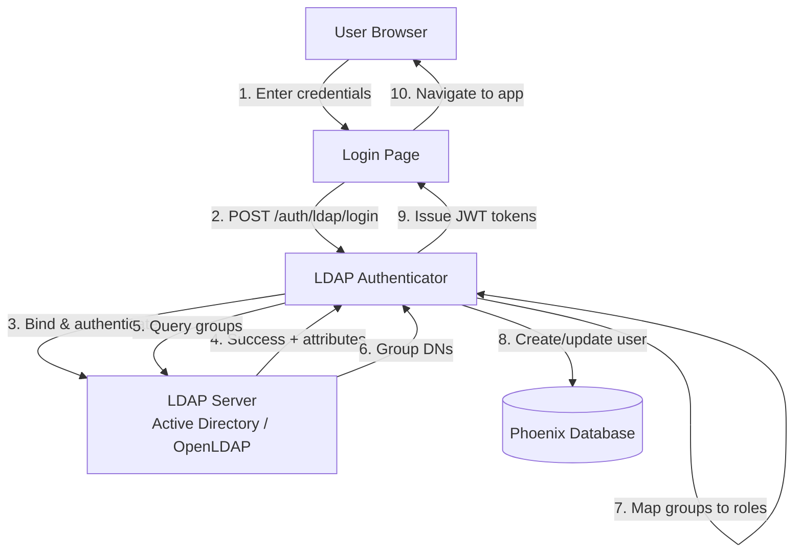

# LDAP Authentication

> **New to LDAP?** Start with the [LDAP Primer for OIDC Engineers](./ldap-authentication/ldap-primer.md). It explains LDAP fundamentals using OIDC as a reference point.

## Summary

Phoenix authenticates users against an LDAP directory, such as Active Directory or OpenLDAP. It maps LDAP groups to Phoenix roles, fails over across replica servers, and follows Grafana's LDAP behavior where the two can match. LDAP coexists with LOCAL and OAuth2 authentication.

The [appendix index](./ldap-authentication/README.md) lists the detailed references.

### References

- GitHub issue: https://github.com/Arize-ai/phoenix/issues/10379
- Grafana LDAP docs: https://grafana.com/docs/grafana/latest/setup-grafana/configure-access/configure-authentication/ldap/
- Grafana source code: https://github.com/grafana/grafana/tree/main/pkg/services/ldap

---

## Decisions

### User Storage

LDAP users are rows in the `users` table with `auth_method='LDAP'`, mapped to the `LDAPUser` ORM subclass alongside `LocalUser` and `OAuth2User`. The table's CHECK constraints enforce these rules for LDAP rows:

- `password_hash`, `password_salt`, `oauth2_client_id`, and `oauth2_user_id` are NULL.
- At least one of `email` and `ldap_unique_id` is present.

See [Database Schema](./ldap-authentication/database-schema.md).

**History**: the December 2025 release could not change the `auth_method` CHECK constraint, so it stored LDAP users as OAuth2 rows marked by `\ue000LDAP(stopgap)` in `oauth2_client_id`, with placeholder emails for users without one. Migration `a1b2c3d4e5f6` (January 2026) moved those rows to `auth_method='LDAP'` and `ldap_unique_id`, made `email` nullable, and removed both markers. The markers now exist only in that migration's upgrade and downgrade logic.

### User Identification

Phoenix identifies an LDAP user by email, or by an immutable unique ID (`objectGUID` or `entryUUID`) when `PHOENIX_LDAP_ATTR_UNIQUE_ID` is set. Phoenix does not identify users by DN, because DNs change when users move between organizational units. See [User Identification Strategy](./ldap-authentication/user-identification-strategy.md) and [Optional Email](./ldap-authentication/optional-email.md).

### Public Contracts

These choices are visible to operators. Changing them would break existing configurations:

1. **Environment variable names** (`PHOENIX_LDAP_*`). See [Configuration Reference](./ldap-authentication/configuration.md).
2. **Group role mapping format**: a JSON array of `{"group_dn": "...", "role": "..."}` objects. The field is `role` rather than Grafana's `org_role`, because Phoenix has no organizations. Role values are Phoenix role names (`ADMIN`, `MEMBER`, `VIEWER`), matched case-insensitively.
3. **Role mapping semantics**: group DNs match case-insensitively, `"*"` matches every user, and the first matching entry determines the role.
4. **`PHOENIX_LDAP_ALLOW_SIGN_UP` defaults to `true`**, as in Grafana. Changing the default would stop new users from signing in on deployments that rely on it.
5. **Value formats**: booleans are the strings `"true"` and `"false"` (case-insensitive), `PHOENIX_LDAP_HOST` is comma-separated, and search filters use `%s` as the username placeholder.

### Configuration Format

Phoenix configures LDAP with environment variables, like the rest of Phoenix. Grafana uses a TOML file. As a consequence:

- Group matching, role mapping, and the login flow behave like Grafana's.
- Operators cannot reuse a Grafana TOML file directly. They must convert it to environment variables.
- Multiple servers must be replicas with identical configuration. Grafana also supports servers with different configurations. Phoenix could add a TOML file later without breaking environment-variable users.

### Authentication Methods

LOCAL, OAuth2, and LDAP can be enabled in any combination that leaves at least one working login method. An account created by one method cannot be signed in to through another. See [Authentication Framework](./ldap-authentication/authentication-framework.md).

---

## Architecture



### Login Flow

1. The user submits an LDAP username and password to `/auth/ldap/login`.
2. Phoenix connects to one of the servers in `PHOENIX_LDAP_HOST`, using LDAPS or STARTTLS.
3. Phoenix binds with the service account, if one is configured.
4. Phoenix searches for the user by username.
5. Phoenix binds as the user to verify the password.
6. Phoenix reads the user's email and display name.
7. Phoenix reads the user's groups, from `memberOf` or from a POSIX group search.
8. Phoenix maps the groups to a role.
9. Phoenix creates or updates the user row.
10. Phoenix issues access and refresh tokens.

The ldap3 library is synchronous, so Phoenix runs each LDAP operation in a worker thread (`anyio.to_thread.run_sync`). If the directory is unreachable, LOCAL and OAuth2 users can still sign in.

### Multiple Servers

```bash
PHOENIX_LDAP_HOST="dc1.corp.com,dc2.corp.com,dc3.corp.com"
```

Phoenix shuffles the servers on each login, to spread load across replicas, and moves to the next server when one raises a connection error. Because the servers are assumed to be replicas, a definitive answer from one server (user not found, wrong password) ends the login without trying the others.

### Group Role Mapping

```bash
PHOENIX_LDAP_GROUP_ROLE_MAPPINGS='[
  {"group_dn": "CN=Phoenix Admins,OU=Groups,DC=corp,DC=com", "role": "ADMIN"},
  {"group_dn": "CN=Phoenix Users,OU=Groups,DC=corp,DC=com", "role": "MEMBER"},
  {"group_dn": "*", "role": "VIEWER"}
]'
```

---

## Security

| Threat | Mitigation |
|--------|-----------|
| LDAP injection | User input is escaped with `ldap3.utils.conv.escape_filter_chars` before it enters a filter |
| Credential exposure | TLS (LDAPS, or STARTTLS before bind); credentials and PII are never logged |
| Username enumeration | Every failure returns the same response; an unknown user still costs a dummy bind |
| Cross-method takeover | Explicit auth-method checks; LDAP sign-up refuses an email that belongs to another method |
| Event loop blocking | LDAP operations run in worker threads with a 10-second connect timeout and a 30-second operation timeout |
| Socket leaks | Connections are unbound in `finally` blocks |
| Brute force | `/auth/ldap/login` is rate limited |
| Man in the middle | TLS certificate verification is on by default |
| Regex complexity (CVE-2024-47764) | Phoenix uses ldap3, not python-ldap |

See [Security Deep-Dive](./ldap-authentication/security.md) for the full threat model, and [Protocol Compliance](./ldap-authentication/protocol-compliance.md) for STARTTLS sequencing, ambiguous search results, and DN canonicalization.

### Operational Risks

| Risk | Impact | Mitigation |
|------|--------|-----------|
| Directory unavailable | LDAP users cannot sign in | Multiple servers; LOCAL and OAuth2 still work |
| Misconfigured group mappings | Wrong roles | Mappings are validated at startup |

---

## Success Criteria

[Implementation Status](#implementation-status) records which criteria tests verify and which remain unvalidated.

**Functional**:
- Active Directory authentication works end-to-end
- OpenLDAP authentication works end-to-end
- Group-based role mapping assigns correct Phoenix roles
- Multiple LDAP servers with failover functions correctly
- Coexists with LOCAL and OAuth2 authentication

**Non-Functional**:
- P95 login latency < 2 seconds
- No security vulnerabilities (LDAP injection, timing attacks)
- Graceful degradation when LDAP unavailable
- Comprehensive audit logging

---

## Implementation Status

LDAP authentication shipped in December 2025 ([release note](../../docs/phoenix/release-notes/12-2025/12-06-2025-ldap-authentication-support.mdx)). The user-facing setup guide is the LDAP section of [`docs/phoenix/self-hosting/features/authentication.mdx`](../../docs/phoenix/self-hosting/features/authentication.mdx). The implementation is in `src/phoenix/server/ldap.py` (authenticator), `src/phoenix/config.py` (`LDAPConfig`), and `src/phoenix/server/api/routers/auth.py` (login endpoint).

### Verified Properties

Tests enforce the following properties. The unit tests are in `tests/unit/server/test_ldap.py` and `tests/unit/test_config.py`, and the integration tests (against an in-process mock LDAP server) are in `tests/integration/auth/test_ldap.py`. The same properties have also been checked against real OpenLDAP servers ([Protocol Compliance §6](./ldap-authentication/protocol-compliance.md#6-real-directory-testing)).

- **STARTTLS before bind**: in STARTTLS mode, the TLS upgrade completes before any bind request is sent. A man-in-the-middle proxy extracted no credentials from Phoenix, and extracted both the service-account and the user credentials from Grafana v11.4 ([Protocol Compliance §7](./ldap-authentication/protocol-compliance.md#7-starttls-implementation--security)).
- **Ambiguous search results**: login is rejected when the user search returns more than one entry.
- **Anonymous bind**: a login with an empty password is rejected before Phoenix contacts the directory.
- **LDAP injection**: filter metacharacters in the username do not change the search filter.
- **Username enumeration**: an invalid password and an unknown user produce the same response, and an unknown user still costs a bind attempt (timing mitigation).
- **Cross-method isolation**: an LDAP login cannot take over a LOCAL or OAuth2 account, and the reverse.
- **Role mapping**: the first matching mapping wins, and `"*"` matches users with no matching group.
- **DN canonicalization**: DNs that differ only in case or spacing identify the same user (RFC 4514).
- **Port defaulting**: an unset `PHOENIX_LDAP_PORT` defaults to 636 in LDAPS mode and to 389 otherwise.

### Not Yet Validated

- Login against a real Active Directory server. Only OpenLDAP has been tested.
- Performance: P95 login latency, connection reuse, behavior when the directory is unavailable, and failover latency across multiple servers.
- A health check that reports LDAP status.

Two properties are implemented but no test covers them: `/auth/ldap/login` is rate limited, and log lines do not contain usernames or DNs.
